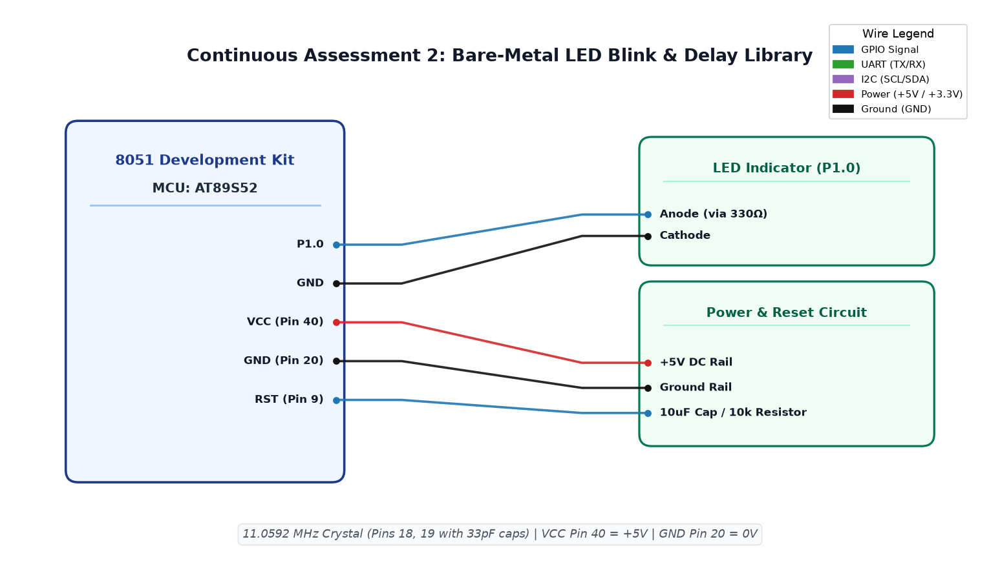

# EXPERIMENT DETAILS

**EXP:** CONTINUOUS ASSESSMENT 2  
**DATE:** 20/07/2026  
**NAME OF EXP:** 8051 Tool Chain Setup, Bare-Metal LED Blink  
**HARDWARE SETUP / PLATFORM:** 8051 Development Kit + AT89S52 MCU + Keil µVision IDE + On-board LED  

> [!NOTE]
> **Reference Attribution:** The implementation code for this experiment is adapted from Vishal Bala's reference repository (`github.com/vishalbala-nps/IoTLabGithub`) for academic reference and verification against the course syllabus.

---

## TASK 2 : Bare-Metal LED Blink

### 1. Circuit Diagram
- **Development Board:** 8051 Generic Development Kit
- **Microcontroller IC:** Atmel AT89S52 (40-pin DIP)
- **GPIO Pins:** 
  - `P1.0` : Output (Connected to LED Anode via 330Ω current-limiting resistor)
- **Peripherals:** Red LED, 330Ω resistor, 11.0592 MHz crystal with 33 pF ceramic capacitors
- **Power Supply:** 
  - `Pin 40 (VCC)`: +5V DC
  - `Pin 20 (GND)`: 0V Ground

### 2. Core Logic / Pseudocode / Code Base

**Working Principle:**  
The AT89S52 microcontroller drives an LED connected to port pin P1.0. A software delay loop generated by nested decrement counters holds the output state for approximately 500 ms before inverting it, producing a steady ~1 Hz blinking pattern without hardware timer peripherals.

**Pseudocode:**
1. Include 8051 standard register definitions `<reg51.h>`.
2. Define `led` as special bit `P1^0`.
3. In `delay()` function, initialize nested `for` loops (200 outer iterations, 400 inner iterations) calibrated to ~0.5 s delay at 11.0592 MHz clock frequency.
4. In `main()`, enter an infinite `while (1)` loop.
5. Set `led = 1` (turns LED ON), call `delay()`.
6. Clear `led = 0` (turns LED OFF), call `delay()`.
7. Repeat indefinitely.

**Code Base:**
- `prog1.c` - Implements the main loop and software delay function for bare-metal blinking.
- `STARTUP.A51` - 8051 startup assembly routine clearing memory and jumping to `main`.
- Project folder: [`TASK_2_Bare_Metal_LED_Blink`](TASK_2_Bare_Metal_LED_Blink/)

### 3. INFERENCE
The bare-metal blinking program was successfully compiled using Keil C51 and executed. The LED connected to P1.0 toggled at approximately 1 Hz. Software delay duration was found to be directly proportional to the clock frequency (11.0592 MHz) and loop iteration counts.

---

## TASK 3 : Custom Delay Library

### 1. Circuit Diagram
- **Development Board:** 8051 Generic Development Kit
- **Microcontroller IC:** Atmel AT89S52
- **GPIO Pins:** 
  - `P1.0` : Output (LED Anode via 330Ω resistor)
- **Peripherals:** Red LED, 11.0592 MHz crystal
- **Power Supply:** VCC (+5V) at Pin 40, GND at Pin 20

### 2. Core Logic / Pseudocode / Code Base

**Working Principle:**  
Modular software engineering principles require abstracting hardware timing into reusable libraries. A standalone delay library (`delay.c`/`delay.h`) provides a parameterized `delay_ms(unsigned int ms)` function calibrated to machine cycles, allowing clean high-level application code without embedded nested loops.

**Pseudocode:**
1. Define header `delay.h` declaring `void delay_ms(unsigned int ms);`.
2. In `delay.c`, implement `delay_ms(ms)` where each millisecond unit executes two 153-pass loops of 3 machine cycles each (~918 machine cycles + loop overhead ≈ 1.0 ms at 11.0592 MHz).
3. In `prog1.c`, include `reg51.h` and `"delay.h"`.
4. In `main()`, continuously alternate `led = 1; delay_ms(500); led = 0; delay_ms(500);`.

**Code Base:**
- `delay.h` - Header file exposing the `delay_ms` function prototype.
- `delay.c` - Implementation of calibrated millisecond delay routine.
- `prog1.c` - High-level application code utilizing the custom delay library.
- Project folder: [`TASK_3_Custom_Delay_Library`](TASK_3_Custom_Delay_Library/)

### 3. INFERENCE
Separating the delay generator into a reusable `delay.c`/`delay.h` library proved cleaner and more accurate than hardcoded loops. Timing accuracy was consistent across varying parameter values, verifying proper machine-cycle calibration for the 11.0592 MHz crystal oscillator.

