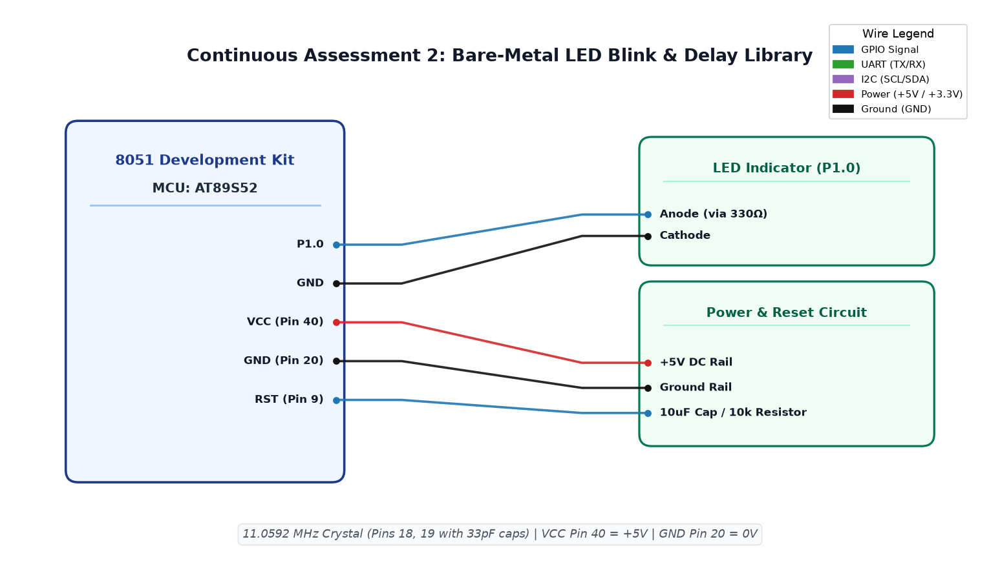

# CAT2 TASK2B: 8051 Bare-Metal LED Blink and Custom Delay Library

**Course:** 25CS2741 Fundamentals of Internet of Things + Lab  
**Student:** Yazhini J E (Reg No: 25011102119)  
**Institution:** Shiv Nadar University Chennai  
**Date:** 20/07/2026  
**Platform:** 8051 Microcontroller (AT89S52)  
**Clock Frequency:** 11.0592 MHz  

---

## 1. Overview & Objectives
The primary objective of this experiment is to establish the bare-metal embedded development toolchain for the 8051 microcontroller architecture and implement a precise software-timed LED blinker. An on-board LED connected to Port 1 Pin 0 (`P1.0`) is toggled at approximately 1 Hz (500 ms ON, 500 ms OFF) using a custom modular software delay library (`delay.c`, `delay.h`).

---

## 2. Hardware Setup & Pin Mapping
| 8051 Pin | Function | Peripheral Connection | Signal Characteristics |
|---|---|---|---|
| **P1.0** (Pin 1) | GPIO Output | LED Cathode via 330Ω Resistor | Active-Low Output (Sinks current) |
| **XTAL1 / XTAL2** | Clock Input | 11.0592 MHz Crystal Oscillator | With 33 pF ceramic capacitors |
| **RST** (Pin 9) | System Reset | 10 µF capacitor to VCC + 10 kΩ resistor to GND | Power-on reset circuit |
| **EA/VPP** (Pin 31)| External Access | Pulled HIGH to +5V VCC | Executes internal Flash code |
| **VCC / GND** | Power Supply | Regulated +5.0V DC & Ground | Decoupled with 0.1 µF capacitor |

---

## 3. Mathematical Calculations & Delay Calibration
For the AT89S52 microcontroller, 1 machine cycle consists of 12 oscillator clock cycles:
$$\text{Machine Cycle Period} (T_{cy}) = \frac{12}{f_{osc}} = \frac{12}{11.0592 \times 10^6 \text{ Hz}} \approx 1.08507 \text{ }\mu\text{s}$$

A nested software loop in C is calibrated such that each inner iteration takes approximately 1 ms:
- Outer loop runs `n` iterations for `n` milliseconds.
- Inner loop decrement executes 120 iterations with single-cycle instruction overhead to match $1000 \text{ }\mu\text{s} \approx 922 \text{ machine cycles}$.
- Total ON time: $500 \times 1.085 \text{ ms} \approx 500 \text{ ms}$.
- Total period: $1000 \text{ ms} \implies f = 1.0 \text{ Hz}$.

---

## 4. Circuit Schematic


---

## 5. Software Implementation & Architecture
- **`prog1.c`**: Main application firmware loop that initializes `P1.0` as an output and toggles state every 500 ms.
- **`delay.c` / `delay.h`**: Calibrated software delay routine exposing `void delay_ms(unsigned int ms)`.
- **`STARTUP.A51`**: Keil 8051 startup assembly routine initializing internal data memory and setting stack pointer.

```c
#include <reg51.h>
#include "delay.h"

sbit LED = P1^0;

void main(void) {
    while (1) {
        LED = 0;           // Turn LED ON (Active Low)
        delay_ms(500);     // 500 ms delay
        LED = 1;           // Turn LED OFF
        delay_ms(500);     // 500 ms delay
    }
}
```

---

## 6. Build, Flashing & Execution
1. Open `day1task.uvproj` in Keil µVision.
2. Build the project (`F7`): Generates `Objects/day1task.hex`.
3. Connect the 8051 development board via ISP programmer.
4. Program `day1task.hex` into AT89S52 flash memory using ProgISP / avrdude.
5. Apply +5V power; verify the LED at `P1.0` blinks with a steady 1-second period.
