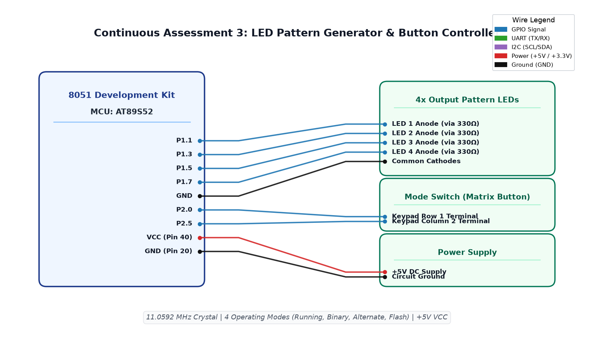

# EXPERIMENT DETAILS

**EXP:** CONTINUOUS ASSESSMENT 3  
**DATE:** 27/07/2026  
**NAME OF EXP:** Timer-Based LED Pattern Generator and Button Interrupt Controller  
**HARDWARE SETUP / PLATFORM:** 8051 Development Kit + AT89S52 + Keil µVision IDE + 4x LEDs + Matrix Push Button  

---

## TASK 1 : Four-Mode LED Pattern Generator and Switch Controller

### 1. Circuit Diagram
- **Development Board:** 8051 Generic Development Kit
- **Microcontroller IC:** Atmel AT89S52
- **GPIO Pins:** 
  - `P1.1` : Output (LED 1 Anode via 330Ω)
  - `P1.3` : Output (LED 2 Anode via 330Ω)
  - `P1.5` : Output (LED 3 Anode via 330Ω)
  - `P1.7` : Output (LED 4 Anode via 330Ω)
  - `P2.0` : Output / Sense Line (Keypad Row 1)
  - `P2.5` : Input / Drive Line (Keypad Column 2, active LOW)
- **Peripherals:** 4x Red LEDs, Push button (configured across matrix row/col), 11.0592 MHz crystal
- **Power Supply:** VCC (+5V) at Pin 40, GND at Pin 20

### 2. Core Logic / Pseudocode / Code Base

**Working Principle:**  
The controller interfaces 4 discrete LEDs on Port 1 with a matrix push button on Port 2. A debounced button scanning routine detects single edge presses and cyclically increments an operational mode variable (0 to 3). Each mode drives a distinct visual pattern on the four LEDs: running LED (ring shift), 4-bit binary counter, alternating pattern (1010/0101), and synchronous flashing.

**Pseudocode:**
1. Configure `col = 0` (drive column low) and `row = 1` (pull row high with internal pull-up).
2. Implement `btn()` function: if `row == 0`, wait software debounce period (~1400 iterations) and re-verify. Return 1 on confirmed press, else 0.
3. In `main()`, initialize `mode = 0`. Enter infinite loop.
4. If `btn()` returns true, wait for key release, debounce, and increment `mode = (mode + 1) % 4`.
5. Execute current mode:
   - **Mode 0 (Running LED):** Shift bit from LED1 to LED4 cyclically (`1 -> 2 -> 4 -> 8 -> 1`).
   - **Mode 1 (Binary Counter):** Display 4-bit value of `count` on LEDs 1–4, increment `count = (count + 1) & 0x0F`.
   - **Mode 2 (Alternate Pattern):** Toggle between `1010` and `0101` bit states.
   - **Mode 3 (All Flash):** Toggle all 4 LEDs simultaneously (all ON, all OFF).
6. Call non-blocking wait / delay between animation steps.

**Code Base:**
- `day2.c` - Implements debounce logic, mode dispatch table, and pattern generation routines for the four states.
- `STARTUP.A51` - Standard startup code for 8051 architecture.
- Project folder: [`.`](.) (Keil project: `day2.uvproj`)

### 3. INFERENCE
Debouncing was crucial to eliminate false multiple trigger events caused by mechanical switch bounce. Each button press cleanly shifted the operating mode through all four sequential states. The four LED patterns were rendered clearly at regular animation intervals.

