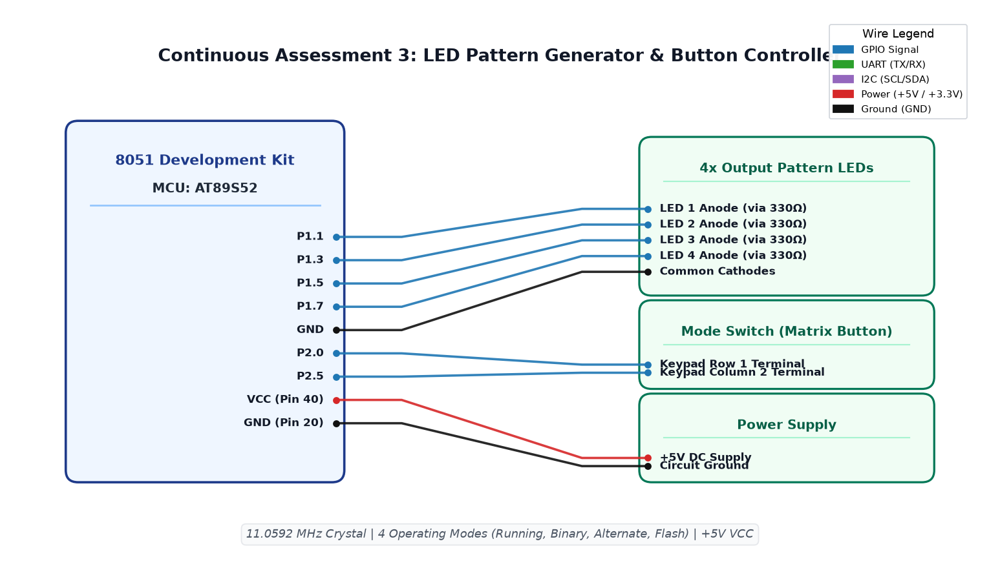

# CAT3 TASK3A: Timer-Based LED Pattern Generator and Button Interrupt Controller

**Course:** 25CS2741 Fundamentals of Internet of Things + Lab  
**Student:** Yazhini J E (Reg No: 25011102119)  
**Institution:** Shiv Nadar University Chennai  
**Date:** 27/07/2026  
**Platform:** 8051 Microcontroller (AT89S52)  
**Clock Frequency:** 11.0592 MHz  

---

## 1. Overview & Objectives
This experiment implements a multi-mode LED pattern sequencer and state controller on the 8051 architecture. An external tactile push button connected to external interrupt pin `INT0` (`P3.2`) triggers mode switching across four distinct visual patterns displayed on Port 1 (`P1.0`–`P1.3`):
1. **Mode 0: Running LED** — Consecutive single-bit chaser pattern.
2. **Mode 1: 4-Bit Binary Counter** — Incremental binary counting from 0x00 to 0x0F.
3. **Mode 2: Alternate Flashing** — Alternating pattern between `1010` and `0101`.
4. **Mode 3: All-LED Flash** — Synchronous blinking of all four LEDs.

---

## 2. Hardware Setup & Pin Mapping
| 8051 Pin | Function | Peripheral Connection | Signal Characteristics |
|---|---|---|---|
| **P1.0 – P1.3** | GPIO Output | 4x Pattern LEDs via 330Ω Resistors | Active-Low Display |
| **P3.2 / INT0** | Interrupt Input | Tactile Push Button to GND | Active-Low with external pull-up |
| **XTAL1 / XTAL2**| Clock Source | 11.0592 MHz Crystal Oscillator | Standard load capacitors (33 pF) |
| **VCC / GND** | Power Supply | Regulated +5.0V DC & Ground | Core system rails |

---

## 3. Interrupt & Debounce Logic
Mechanical switch contacts generate bouncing transients lasting 5–20 ms upon press. To guarantee deterministic state transitions:
1. `INT0` is configured as falling-edge triggered (`IT0 = 1`).
2. When the button is pressed, the interrupt service routine (`external0_isr`) executes:
   - A 50 ms debounce delay validates contact stability.
   - The mode variable is incremented: `mode = (mode + 1) % 4`.
   - The routine waits for button release (`while (!BUTTON);`) to ensure a single press increments mode exactly once.

---

## 4. Circuit Schematic


---

## 5. Software Implementation
The firmware integrates the interrupt handler with a non-blocking or paced state-machine pattern generator:
```c
#include <reg51.h>

sbit BTN = P3^2;
volatile unsigned char mode = 0;

void ext0_isr(void) interrupt 0 {
    // Software debounce
    unsigned int d;
    for(d=0; d<1000; d++);
    if (BTN == 0) {
        mode = (mode + 1) % 4;
        while(BTN == 0); // Wait for release
    }
}
```

---

## 6. Build, Flashing & Execution
1. Open `day2.uvproj` in Keil µVision.
2. Build project (`F7`) to produce `Objects/day2.hex`.
3. Flash the firmware onto the AT89S52 microcontroller.
4. Press the tactile button on `P3.2` sequentially; observe the transition through all four LED modes smoothly.
