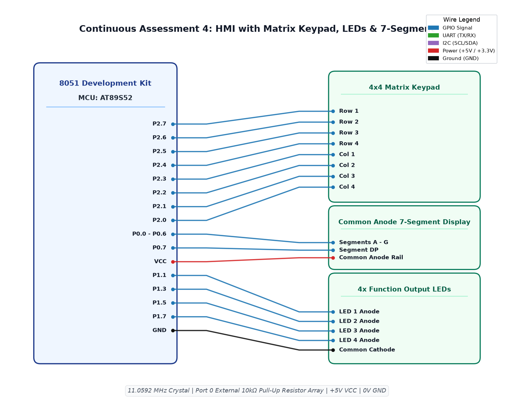

# EXPERIMENT DETAILS

**EXP:** CONTINUOUS ASSESSMENT 4  
**DATE:** 03/08/2026  
**NAME OF EXP:** Human-Machine Interface using Matrix Keypad, LEDs, and Seven-Segment Display  
**HARDWARE SETUP / PLATFORM:** 8051 Development Kit + AT89S52 + Keil µVision IDE + 4x4 Matrix Keypad + 7-Segment Display + 4x LEDs  

> [!NOTE]
> **Reference Attribution:** The implementation code for this experiment is adapted from Vishal Bala's reference repository (`github.com/vishalbala-nps/IoTLabGithub`) for academic reference and verification against the course syllabus.

---

## TASK 1 : Matrix Keypad Scanning with 7-Segment Feedback and LED Mode Controller

### 1. Circuit Diagram
- **Development Board:** 8051 Generic Development Kit
- **Microcontroller IC:** Atmel AT89S52
- **GPIO Pins:** 
  - `P2.7 - P2.4` : Row 1 to Row 4 Outputs (Scan Lines)
  - `P2.3 - P2.0` : Column 1 to Column 4 Inputs (Sense Lines with internal pull-ups)
  - `P0.0 - P0.7` : Output Bus to Seven-Segment Display (Segments A through G, DP via 10kΩ pull-up network)
  - `P1.1, P1.3, P1.5, P1.7` : Output to LEDs 1, 2, 3, 4 (via 330Ω resistors)
- **Peripherals:** 4x4 Matrix Keypad, 1-Digit Common Anode/Cathode Seven-Segment Display, 4x Red LEDs, 10kΩ resistor pull-up array on Port 0
- **Power Supply:** VCC (+5V) at Pin 40, GND at Pin 20

### 2. Core Logic / Pseudocode / Code Base

**Working Principle:**  
A matrix keypad scanner sequentially pulls each row LOW and reads column input states to identify pressed keys (0 through 9). The decoded numeric value is displayed on a 7-segment display via Port 0. Concurrently, the selected key index directs the operating mode of 4 discrete LEDs on Port 1: keys 1–4 activate the corresponding individual LED, key 5 initiates running LED, key 6 toggles alternate LED pairs, key 7 runs a 4-bit binary counter, key 8 blinks all LEDs, key 9 turns all LEDs off, and key 0 resets the system.

**Pseudocode:**
1. Initialize Port 0 (Display) and Port 1 (LEDs) to known idle states.
2. Define matrix scanning function `btn()`:
   - For each row (1 to 4), drive the target row LOW while keeping others HIGH.
   - Sample columns 1 through 4. If any column is LOW, delay ~1400 iterations for contact debounce and confirm state.
   - Return detected key digit (0–9), or -1 if no key pressed.
3. In `displayNumber(int no)`:
   - Output corresponding 7-segment segment hex code to `P0` (e.g., `0x3F` for 0, `0x06` for 1, etc.).
4. In `main()` loop:
   - Poll `btn()`. When a valid key is returned, update `displayNumber(key)` on the 7-segment display.
   - Dispatch to corresponding LED routine:
     - Keys 1–4: Call `glowLed(key)` to turn ON that single LED.
     - Key 5: Execute `running_led` sequence.
     - Key 6: Call `glowPair()` for alternating pairs.
     - Key 7: Call `glowBinary()` cycling 0–15.
     - Key 8: Call `glowAll(1)` / `glowAll(0)` to blink all LEDs.
     - Key 9: Call `glowAll(0)` to turn all LEDs OFF.
     - Key 0: Reset all states to initial condition.

**Code Base:**
- `sevensg.c` - Implements matrix row-column keypad scanning, 7-segment decoder table, and 10-state LED actuation functions.
- `STARTUP.A51` - Standard startup code for 8051.
- Project folder: [`.`](.) (Keil project: `sevenseg.uvproj`)

### 3. INFERENCE
Interfacing an input matrix keypad and output 7-segment display demonstrated coordinated HMI design on the 8051. The scanning algorithm reliably resolved simultaneous key presses into unambiguous digit detections, providing immediate visual confirmation on the 7-segment display and correct multi-mode control across all LEDs.

