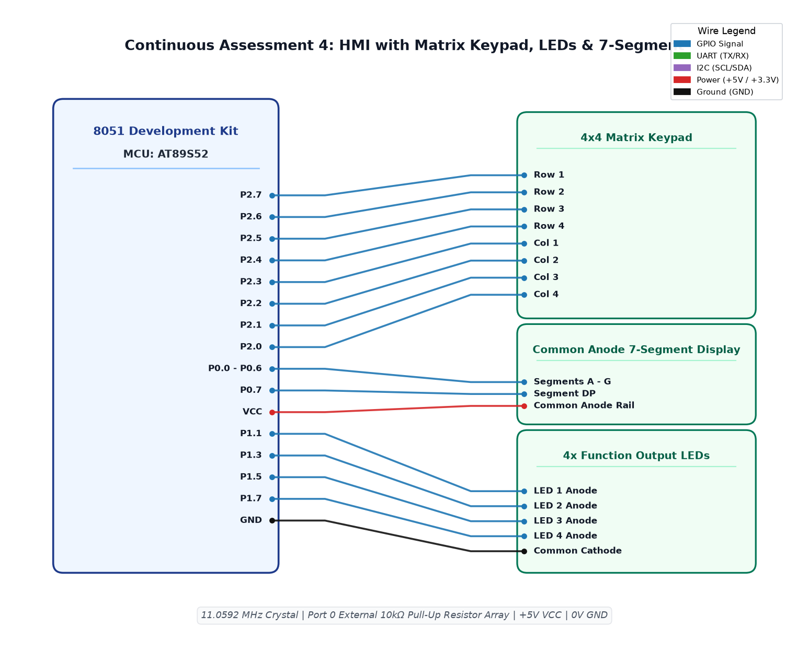

# CAT4 TASK4A: Human-Machine Interface using Matrix Keypad, LEDs, and Seven-Segment Display

**Course:** 25CS2741 Fundamentals of Internet of Things + Lab  
**Student:** Yazhini J E (Reg No: 25011102119)  
**Institution:** Shiv Nadar University Chennai  
**Date:** 03/08/2026  
**Platform:** 8051 Microcontroller (AT89S52)  
**Clock Frequency:** 11.0592 MHz  

---

## 1. Overview & Objectives
This experiment designs a complete Human-Machine Interface (HMI) integrating three primary peripheral subsystems:
1. **4x4 Matrix Keypad** on Port 2 for numeric and functional command input.
2. **7-Segment Display** on Port 0 for visual numeric feedback.
3. **8-LED Pattern Bar** on Port 1 for status and animated visual indicators.

### Functional Matrix:
- Pressing keys **`1` – `4`**: Illuminates corresponding individual LED (LED1 to LED4).
- Pressing key **`5`**: Triggers Running LED animation sequence.
- Pressing key **`6`**: Triggers Alternate Flashing pattern (`0xAA` / `0x55`).
- Pressing key **`7`**: Triggers 4-bit Binary Counter sequence (0 to 15).
- Pressing key **`8`**: Blinks all LEDs synchronously.
- Pressing key **`9`**: Turns all LEDs OFF.
- Pressing key **`0`**: System Reset / Clear display and LEDs.

---

## 2. Hardware Setup & Pin Mapping
| Subsystem | 8051 Port Pins | Interfaced Peripheral Pins | Description |
|---|---|---|---|
| **Matrix Keypad** | `P2.0 – P2.3` | Rows R1 – R4 | Row output drive pins |
| **Matrix Keypad** | `P2.4 – P2.7` | Columns C1 – C4 | Column input sensing pins |
| **7-Segment Display** | `P0.0 – P0.6` | Segments `a` – `g` | Common cathode display segment bus |
| **LED Bar** | `P1.0 – P1.7` | 8x Discrete LEDs | Active-low LED pattern indicators |

---

## 3. Matrix Keypad Scanning Algorithm
The scanning routine drives one row LOW at a time and samples the four column inputs:
1. Set Port 2 rows high, pull `R1` LOW (`P2 = 0xFE`). Read column nibble `P2 & 0xF0`.
2. Repeat for `R2` (`0xFD`), `R3` (`0xFB`), and `R4` (`0xF7`).
3. If any column pin reads `0`, a keypress is identified at the intersection.
4. Lookup table maps row/col index to key value ('0'-'9', 'A'-'D', '*', '#').
5. The 7-segment display decodes digits via array: `code unsigned char seg_lut[10] = {0x3F, 0x06, 0x5B, 0x4F, 0x66, 0x6D, 0x7D, 0x07, 0x7F, 0x6F};`.

---

## 4. Circuit Schematic

---

## 5. Build, Flashing & Execution
1. Open `sevenseg.uvproj` in Keil µVision.
2. Build the project (`F7`) to generate `Objects/sevenseg.hex`.
3. Program hex into AT89S52 flash memory.
4. Verify by pressing matrix keypad buttons; the exact digit appears on the 7-segment display and the corresponding LED pattern is actuated.
