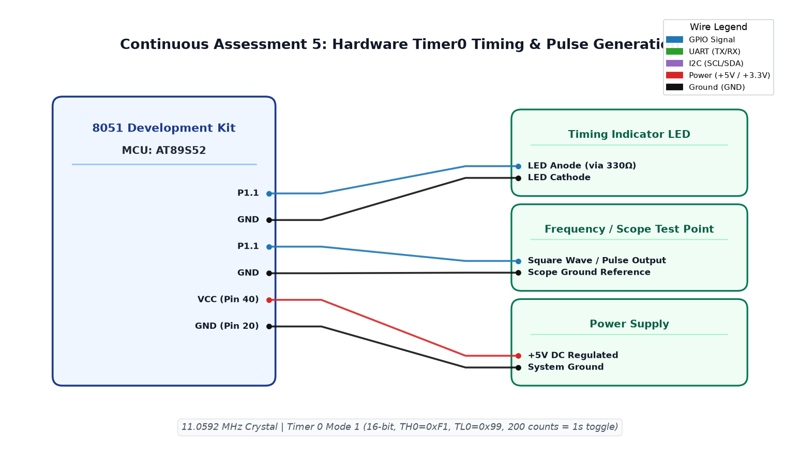

# CAT5 TASK5B.3: Dual-Tone and Frequency Sweep Pulse Generator (100 Hz – 5 kHz)

**Course:** 25CS2741 Fundamentals of Internet of Things + Lab  
**Student:** Yazhini J E (Reg No: 25011102119)  
**Institution:** Shiv Nadar University Chennai  
**Date:** 10/08/2026  
**Platform:** 8051 Microcontroller (AT89S52)  
**Clock Frequency:** 11.0592 MHz  

---

## 1. Overview & Objectives
This experiment designs a wide-band audio tone and pulse generator spanning audible frequencies from **100 Hz to 5 kHz** on `P1.2`. The firmware employs an interrupt-driven reload lookup table to synthesize stepped audio tones and frequency sweeps for piezoelectric transducer / acoustic alert sirens.

---

## 2. Frequency Lookup Table Synthesis
| Frequency | Period ($T$) | Half-Period ($T/2$) | Machine Cycles | Reload (Hex) |
|---|---|---|---|---|
| **100 Hz** | 10.0 ms | 5000 µs | 4608 | `0xEE00` |
| **500 Hz** | 2.0 ms | 1000 µs | 922 | `0xFC66` |
| **1000 Hz** | 1.0 ms | 500 µs | 461 | `0xFE33` |
| **2500 Hz** | 400 µs | 200 µs | 184 | `0xFF48` |
| **5000 Hz** | 200 µs | 100 µs | 92 | `0xFFA4` |

---

## 3. Circuit Schematic

---

## 4. Build, Flashing & Execution
1. Open `freq_sweep.uvproj` in Keil µVision.
2. Build project to produce `Objects/freq_sweep.hex`.
3. Program into AT89S52; connect a piezo buzzer between `P1.2` and VCC; hear the stepping tone siren sequence.
