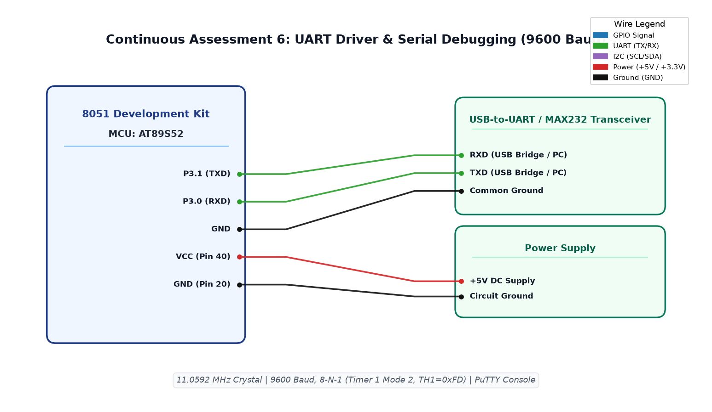

# EXPERIMENT DETAILS

**EXP:** CONTINUOUS ASSESSMENT 6  
**DATE:** 17/08/2026  
**NAME OF EXP:** UART Driver and Serial Debugging  
**HARDWARE SETUP / PLATFORM:** 8051 Development Kit + AT89S52 + Keil µVision IDE + MAX232 / USB-to-UART Adapter + Serial Terminal (PuTTY)  

> [!NOTE]
> **Reference Attribution:** The implementation code for this experiment is adapted from Vishal Bala's reference repository (`github.com/vishalbala-nps/IoTLabGithub`) for academic reference and verification against the course syllabus.

---

## TASK 6A : UART Initialization and Continuous String Transmission

### 1. Circuit Diagram
- **Development Board:** 8051 Generic Development Kit
- **Microcontroller IC:** Atmel AT89S52
- **GPIO Pins:** 
  - `P3.1 (TXD)` : Serial Data Transmit (Connected to RXD of USB-UART adapter / MAX232)
  - `P3.0 (RXD)` : Serial Data Receive (Connected to TXD of USB-UART adapter)
- **Peripherals:** USB-to-UART converter (CP2102/CH340), 11.0592 MHz crystal
- **Power Supply:** VCC (+5V) at Pin 40, GND at Pin 20

### 2. Core Logic / Pseudocode / Code Base

**Working Principle:**  
Serial asynchronous communication requires generating a standardized baud rate (9600 bps) using on-chip Timer 1 in 8-bit auto-reload mode (Mode 2). With an 11.0592 MHz crystal, setting reload register `TH1 = 0xFD` establishes standard 9600-8-N-1 framing. The MCU continuously transmits the string `"Hello from 8051\r\n"` over the serial bus to a connected PC terminal emulator.

**Baud Rate Calculation:**
$$\text{Baud Rate} = \frac{2^{\text{SMOD}}}{32} \times \frac{f_{\text{osc}}}{12 \times (256 - \text{TH1})}$$
For $\text{SMOD}=0$, $f_{\text{osc}} = 11.0592 \text{ MHz}$:
$$9600 = \frac{1}{32} \times \frac{11059200}{12 \times (256 - \text{TH1})} \implies 256 - \text{TH1} = 3 \implies \text{TH1} = 253 = \text{0xFD}$$

**Pseudocode:**
1. Configure `TMOD = 0x20` (Timer 1, Mode 2, 8-bit auto-reload).
2. Set `TH1 = 0xFD` and `TL1 = 0xFD` for 9600 baud rate.
3. Configure `SCON = 0x50` (Mode 1: 8-bit UART, variable baud, Receiver Enabled `REN = 1`).
4. Start Timer 1 by setting `TR1 = 1`.
5. Implement `sendChar(char c)`:
   - Write byte `SBUF = c`.
   - Poll `while (TI == 0)` until transmit interrupt flag is set by hardware.
   - Clear `TI = 0`.
6. Implement `sendString(char *str)`: iterate characters in pointer, transmitting each via `sendChar()`, followed by `\r\n`.
7. In `main()`, continuously send `"Hello from 8051"` with an inter-packet delay.

**Code Base:**
- `prog1.c` - Implements UART driver, baud rate configuration, string serialization, and transmit loop.
- `STARTUP.A51` - Standard 8051 startup file.
- Project folder: [`TASK_A_UART_Initialization_and_Character_Transmission`](TASK_A_UART_Initialization_and_Character_Transmission/)

### 3. INFERENCE
The AT89S52 successfully initialized UART communications at 9600-8-N-1. The transmitted string `"Hello from 8051"` was received without framing or parity errors on PuTTY, confirming correct Timer 1 auto-reload calculation.

---

## TASK 6B : UART Character Echo and Interactive Terminal

### 1. Circuit Diagram
- **Development Board:** 8051 Generic Development Kit
- **Microcontroller IC:** Atmel AT89S52
- **GPIO Pins:** 
  - `P3.1 (TXD)` : Transmit Pin
  - `P3.0 (RXD)` : Receive Pin
- **Peripherals:** USB-UART bridge, 11.0592 MHz crystal
- **Power Supply:** VCC (+5V), GND (0V)

### 2. Core Logic / Pseudocode / Code Base

**Working Principle:**  
Bi-directional full-duplex communication is established by polling the receive interrupt flag `RI`. When a character is typed into the PC terminal, the hardware loads it into `SBUF` and asserts `RI = 1`. The program reads the character, clears `RI`, and immediately echoes the character back to the transmitter via `sendChar()`, providing real-time interactive feedback on the terminal screen.

**Pseudocode:**
1. Initialize UART at 9600-8-N-1 (`SCON = 0x50`, `TMOD = 0x20`, `TH1 = 0xFD`, `TR1 = 1`).
2. Transmit welcoming banner `"Hello from 8051!!!"`.
3. Implement `getChar()`:
   - Poll `while (RI == 0)` until byte is received in hardware buffer.
   - Read received byte `c = SBUF`.
   - Clear `RI = 0`.
   - Return character `c`.
4. In `main()` loop:
   - Call `rec = getChar()`.
   - Call `sendChar(rec)` to echo back the received character.

**Code Base:**
- `prog1.c` - Implements blocking receive routine (`getChar`) and continuous character loopback echo.
- `STARTUP.A51` - Standard 8051 startup file.
- Project folder: [`TASK_B_UART_Echo`](TASK_B_UART_Echo/)

### 3. INFERENCE
Full-duplex serial loopback was successfully demonstrated. Each keystroke entered in PuTTY was received by the 8051 via `RXD` and reflected back across `TXD` with zero noticeable latency or character corruption.

