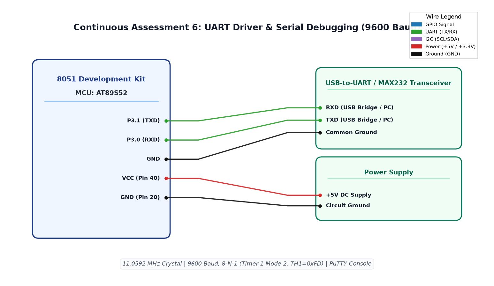

# CAT6 TASK6A: 8051 UART Driver Initialization and Continuous String Transmission

**Course:** 25CS2741 Fundamentals of Internet of Things + Lab  
**Student:** Yazhini J E (Reg No: 25011102119)  
**Institution:** Shiv Nadar University Chennai  
**Date:** 17/08/2026  
**Platform:** 8051 Microcontroller (AT89S52)  
**Clock Frequency:** 11.0592 MHz  

---

## 1. Overview & Objectives
This experiment establishes asynchronous serial serial communication on the 8051 architecture. The on-chip UART is configured in **Mode 1** (8-bit UART, variable baud rate generated by Timer1 in Mode 2 auto-reload) at **9600 baud, 8-N-1**. The microcontroller continuously broadcasts the string `"Hello from 8051!\r\n"` over `TXD` (`P3.1`) to an attached PC host terminal.

---

## 2. Baud Rate Generation Mathematical Derivation
For Timer1 in Mode 2 (8-bit auto-reload) with crystal $f_{osc} = 11.0592 \text{ MHz}$ and $SMOD = 0$:
$$\text{Baud Rate} = \frac{2^{SMOD}}{32} \times \frac{f_{osc}}{12 \times (256 - TH1)}$$
$$9600 = \frac{1}{32} \times \frac{11059200}{12 \times (256 - TH1)} = \frac{28800}{256 - TH1}$$
$$256 - TH1 = \frac{28800}{9600} = 3 \implies \mathbf{TH1 = 256 - 3 = 253 = 0\text{xFD}}$$

---

## 3. Register Configuration
- **`SCON = 0x50`**: Mode 1 (8-bit UART), Receiver Enabled (`REN = 1`).
- **`TMOD = 0x20`**: Timer1 configured in Mode 2 (8-bit Auto-Reload).
- **`TH1 = 0xFD`, `TL1 = 0xFD`**: Auto-reload constant for 9600 baud.
- **`TR1 = 1`**: Start Timer1.
- **`TI = 1`**: Preset Transmit Interrupt flag to allow initial `printf` / character transmission.

---

## 4. Circuit Schematic

---

## 5. Build, Flashing & Execution
1. Open `uartcommunication.uvproj` in Keil µVision.
2. Build project to output `Objects/uartcommunication.hex`.
3. Flash the AT89S52; connect USB-to-UART converter (`TXD`->`RXD`, `GND`->`GND`).
4. Launch PuTTY or Tera Term configured to **9600 baud, 8 data bits, no parity, 1 stop bit**.
5. Observe continuous transmission of `"Hello from 8051!"`.
