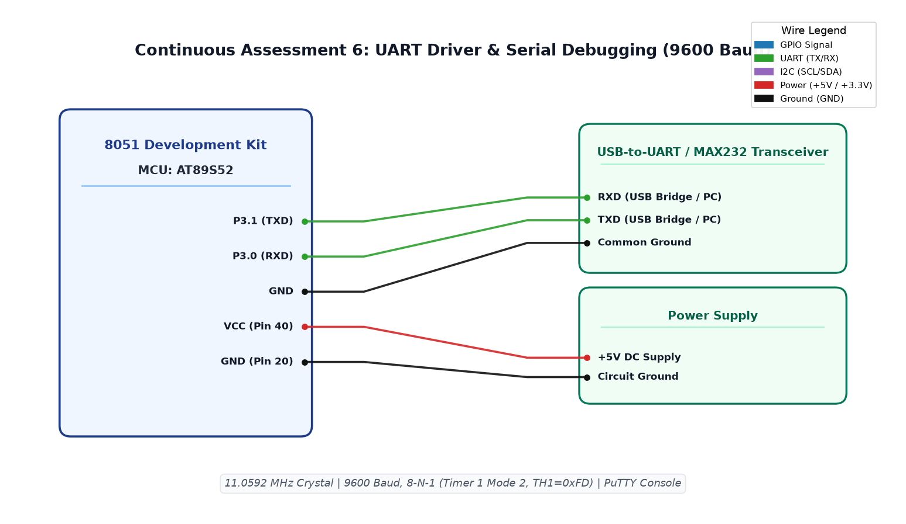

# CAT6 TASK6B: Interactive UART Serial Character Echo Console

**Course:** 25CS2741 Fundamentals of Internet of Things + Lab  
**Student:** Yazhini J E (Reg No: 25011102119)  
**Institution:** Shiv Nadar University Chennai  
**Date:** 17/08/2026  
**Platform:** 8051 Microcontroller (AT89S52)  
**Clock Frequency:** 11.0592 MHz  

---

## 1. Overview & Objectives
This experiment implements a full-duplex interactive UART echo console on the 8051 microcontroller. Characters typed into a PC serial terminal (e.g. PuTTY) are transmitted across serial lines, received by the 8051 on `RXD` (`P3.0`), buffered, and immediately echoed back over `TXD` (`P3.1`) with proper carriage return (`\r`) and newline (`\n`) formatting.

---

## 2. Serial Communication Protocol & Flow
1. Microcontroller polls the Receive Interrupt flag (`RI`): `while (RI == 0);`.
2. Reads incoming ASCII character byte from `SBUF`: `char c = SBUF; RI = 0;`.
3. If `c == '\r'`, transmits both `\r` and `\n` so terminal line feeds correctly.
4. Transmits character back by loading `SBUF = c;` and waiting for `TI == 1; TI = 0;`.

---

## 3. Circuit Schematic

---

## 4. Build, Flashing & Execution
1. Open `uartcommunication.uvproj` in Keil µVision.
2. Build project to generate `Objects/uartcommunication.hex`.
3. Program AT89S52 microcontroller.
4. Open serial terminal at 9600 baud; type characters on your keyboard and observe instant remote echo on the screen.
