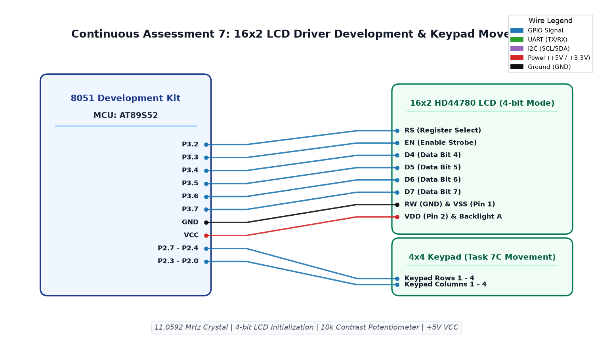

# EXPERIMENT DETAILS

**EXP:** CONTINUOUS ASSESSMENT 7  
**DATE:** 24/08/2026  
**NAME OF EXP:** 16x2 LCD Driver Development and Dynamic Display Control  
**HARDWARE SETUP / PLATFORM:** 8051 Development Kit + AT89S52 + Keil µVision IDE + 16x2 HD44780 LCD Display + 4x4 Matrix Keypad  

---

## TASK 7A : LCD Initialization and Character / String Display

### 1. Circuit Diagram
- **Development Board:** 8051 Generic Development Kit
- **Microcontroller IC:** Atmel AT89S52
- **GPIO Pins:** 
  - `P3.2` : Output -> `RS` (Register Select: 0=Command, 1=Data)
  - `P3.3` : Output -> `EN` (Enable Clock Strobe)
  - `P3.4 - P3.7` : Output -> `D4 - D7` (High-order 4-bit Data Bus)
  - `RW` Pin of LCD tied to GND (Write-only mode)
- **Peripherals:** 16x2 Alphanumeric LCD module (HD44780 compliant), 10kΩ contrast potentiometer
- **Power Supply:** VDD (+5V), VSS (0V), Backlight A (+5V via 220Ω), Backlight K (GND)

### 2. Core Logic / Pseudocode / Code Base

**Working Principle:**  
To conserve I/O pins, the HD44780 LCD controller is operated in 4-bit nibble mode. Initialization involves sending a sequence of timed commands (`0x33`, `0x32`, `0x28` for 4-bit 2-line 5x8 font, `0x0C` for display ON cursor OFF, `0x06` for entry mode increment, and `0x01` for display clear). Each byte is sent as two sequential 4-bit nibbles (higher nibble followed by lower nibble) strobing `EN` high for ≥50 µs.

**Pseudocode:**
1. Implement `send_nibble(bit b3, bit b2, bit b1, bit b0)` to assign bits to `P3.4–P3.7` and pulse `EN` HIGH then LOW.
2. Implement `lcd_write(unsigned char val)` to partition a byte into upper and lower nibbles.
3. Define `lcd_cmd(unsigned char cmd)`: set `RS = 0`, call `lcd_write(cmd)`.
4. Define `lcd_data(unsigned char dat)`: set `RS = 1`, call `lcd_write(dat)`.
5. In `lcd_init()`:
   - Delay >15 ms for power stabilization.
   - Send 4-bit reset sequence: `0x02`, `0x28`, `0x0C`, `0x06`, `0x01`.
6. Implement `lcd_print(char *str)`: stream ASCII characters to `lcd_data()`.
7. In `main()`: initialize LCD and display test banner `"Hello World"` / `"IoT Lab SNUC"`.

**Code Base:**
- `lcd.c` - Implements low-level 4-bit nibble driver, command/data registers, and string printing routines.
- `STARTUP.A51` - Standard 8051 startup file.
- Project folder: [`TASK_7A_LCD_Initialization_and_Character_String_Display`](TASK_7A_LCD_Initialization_and_Character_String_Display/)

### 3. INFERENCE
Operating the 16x2 LCD in 4-bit mode halved the required MCU data lines from 8 down to 4 with zero degradation in refresh speed or visual clarity. Characters rendered accurately across both display lines.

---

## TASK 7B : Cursor Positioning and Dynamic Value Update

### 1. Circuit Diagram
- **Development Board:** 8051 Generic Development Kit
- **Microcontroller IC:** Atmel AT89S52
- **GPIO Pins:** `P3.2` (RS), `P3.3` (EN), `P3.4-P3.7` (D4-D7)
- **Peripherals:** 16x2 Alphanumeric LCD display
- **Power Supply:** VCC (+5V), GND (0V)

### 2. Core Logic / Pseudocode / Code Base

**Working Principle:**  
Direct DDRAM addressing enables positioning the display cursor at arbitrary row and column coordinates. Line 1 begins at address `0x80`, while Line 2 begins at `0xC0`. Dynamic numeric variables are decomposed into decimal digits, converted to ASCII (`val + '0'`), and refreshed periodically at specific cursor positions without clearing the static labels on the rest of the screen.

**Pseudocode:**
1. Define `lcd_goto(unsigned char row, unsigned char col)`:
   - If `row == 1`, send command `0x80 + col`.
   - If `row == 2`, send command `0xC0 + col`.
2. Define `lcd_print_number(unsigned int num)`:
   - Break number into individual decimal digits (hundreds, tens, units).
   - Write each digit via `lcd_data(digit + '0')`.
3. In `main()`:
   - Call `lcd_goto(1, 0)` and print static header `"COUNTER TEST"`.
   - In loop, call `lcd_goto(2, 5)`, update incrementing numeric count, and delay 500 ms.

**Code Base:**
- `lcd.c` - Implements DDRAM address calculations (`lcd_goto`) and dynamic integer formatting.
- `STARTUP.A51` - Standard 8051 startup file.
- Project folder: [`TASK_7B_Cursor_Positioning_and_Dynamic_Value_Update`](TASK_7B_Cursor_Positioning_and_Dynamic_Value_Update/)

### 3. INFERENCE
Targeted DDRAM cursor positioning eliminated screen flickering caused by full-display clears (`0x01`). Numeric counter updates refreshed seamlessly in real time while maintaining the static title on Line 1.

---

## TASK 7C : Keypad-Based Interactive Character Navigation

### 1. Circuit Diagram
- **Development Board:** 8051 Generic Development Kit
- **Microcontroller IC:** Atmel AT89S52
- **GPIO Pins:** 
  - `P3.2 - P3.7` : LCD RS, EN, and D4–D7 lines
  - `P2.7 - P2.4` : Matrix Keypad Rows 1–4
  - `P2.3 - P2.0` : Matrix Keypad Columns 1–4
- **Peripherals:** 16x2 LCD display, 4x4 matrix keypad
- **Power Supply:** VCC (+5V), GND (0V)

### 2. Core Logic / Pseudocode / Code Base

**Working Principle:**  
Integrates matrix keypad input with dynamic LCD cursor steering to implement interactive navigation. Keys 2, 8, 4, and 6 correspond to navigational directions (UP, DOWN, LEFT, RIGHT). The current cursor coordinates $(r, c)$ are constrained within boundary limits ($r \in [1, 2]$ and $c \in [0, 15]$). When a navigation key is pressed, the character at the previous position is cleared, coordinates are updated, and the cursor/character is redrawn at the new coordinate.

**Pseudocode:**
1. Maintain cursor coordinates `curr_row = 1`, `curr_col = 0`.
2. Continuously poll 4x4 keypad via `keypad_scan()`:
   - Key '2' (UP): If `curr_row > 1`, decrement `curr_row`.
   - Key '8' (DOWN): If `curr_row < 2`, increment `curr_row`.
   - Key '4' (LEFT): If `curr_col > 0`, decrement `curr_col`.
   - Key '6' (RIGHT): If `curr_col < 15`, increment `curr_col`.
3. If movement detected:
   - Overwrite old position with blank space `' '`.
   - Call `lcd_goto(curr_row, curr_col)`.
   - Write character marker (e.g., `'*'` or `'>'`).
4. Apply debounce delay and await key release.

**Code Base:**
- `lcd.c` - Implements interactive 2D coordinate bounds checking and keypad directional control.
- `STARTUP.A51` - Standard 8051 startup file.
- Project folder: [`TASK_7C_Keypad_Based_Character_Movement`](TASK_7C_Keypad_Based_Character_Movement/)

### 3. INFERENCE
Interactive character steering across the 16x2 character grid operated with zero boundary overrun errors. Keystroke detection mapped reliably to spatial cursor movements, verifying proper integration of keypad scanning and DDRAM addressing.

