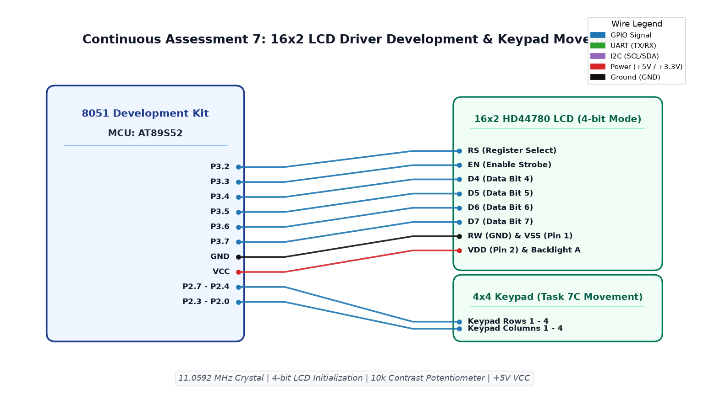

# CAT7 TASK7A: 16x2 Character LCD 4-Bit Driver and Static Text Display

**Course:** 25CS2741 Fundamentals of Internet of Things + Lab  
**Student:** Yazhini J E (Reg No: 25011102119)  
**Institution:** Shiv Nadar University Chennai  
**Date:** 24/08/2026  
**Platform:** 8051 Microcontroller (AT89S52)  
**Clock Frequency:** 11.0592 MHz  

---

## 1. Overview & Objectives
This experiment develops a custom 4-bit parallel driver for an alphanumeric HD44780 16x2 character Liquid Crystal Display (LCD). Operating the LCD in 4-bit nibble mode reduces required micro-controller I/O pins from 11 down to 6. The firmware implements core driver routines (`lcd_cmd`, `lcd_data`, `lcd_init`, `lcd_puts`) and displays a static welcome banner.

---

## 2. Hardware Setup & Pin Interfacing
| LCD Pin | Pin Name | 8051 Connection | Function Description |
|---|---|---|---|
| **Pin 1** | VSS | Ground | 0V Power Supply |
| **Pin 2** | VDD | +5V VCC | +5.0V Logic Power |
| **Pin 3** | V0 | 10 kΩ Potentiometer wiper | Contrast Adjustment |
| **Pin 4** | RS | `P2.0` | Register Select: 0=Instruction, 1=Data |
| **Pin 5** | RW | GND | Read/Write: Tied to GND for Write-Only |
| **Pin 6** | E | `P2.1` | Enable strobe latch pin (Active high pulse) |
| **Pins 11–14** | D4 – D7 | `P2.4 – P2.7` | High-order 4-bit data bus |
| **Pins 15, 16** | BLA, BLK | +5V (via 220Ω) / GND | LED Backlight Anode & Cathode |

---

## 3. 4-Bit Initialization Protocol
To force the HD44780 controller into 4-bit mode reliably regardless of power-on state:
1. Wait > 15 ms after VCC rises to 4.5V.
2. Send command nibble `0x03`, pulse Enable; wait > 4.1 ms.
3. Send command nibble `0x03`, pulse Enable; wait > 100 µs.
4. Send command nibble `0x03`, pulse Enable.
5. Send command nibble `0x02` to switch interface to 4 bits wide.
6. Function Set: `0x28` (4-bit, 2 lines, 5x8 font).
7. Display Control: `0x0C` (Display ON, Cursor OFF).
8. Clear Display: `0x01` (clears DDRAM and returns home).
9. Entry Mode Set: `0x06` (increment cursor, no display shift).

---

## 4. Circuit Schematic

---

## 5. Build, Flashing & Execution
1. Open `lcd.uvproj` in Keil µVision.
2. Build project to create `Objects/lcd.hex`.
3. Flash the AT89S52; adjust contrast pot until characters appear clear and sharp.
