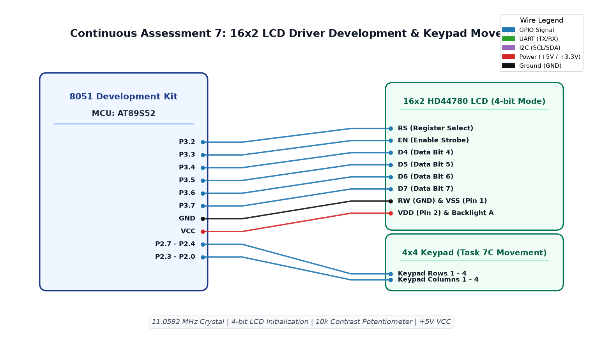

# CAT7 TASK7B: LCD Dynamic Cursor Positioning and Telemetry Counter

**Course:** 25CS2741 Fundamentals of Internet of Things + Lab  
**Student:** Yazhini J E (Reg No: 25011102119)  
**Institution:** Shiv Nadar University Chennai  
**Date:** 24/08/2026  
**Platform:** 8051 Microcontroller (AT89S52)  
**Clock Frequency:** 11.0592 MHz  

---

## 1. Overview & Objectives
This experiment expands the 16x2 LCD driver by introducing dynamic cursor addressing (`lcd_goto(row, col)`) and numeric telemetry formatting (`lcd_print_number(val)`). Line 1 maintains a static label while Line 2 displays a continuously updating real-time decimal integer counter.

---

## 2. DDRAM Address Memory Map
The HD44780 controller maps lines to distinct Display Data RAM (DDRAM) address offsets:
- **Line 1:** Addresses `0x00` to `0x0F` (Command `0x80 | col`).
- **Line 2:** Addresses `0x40` to `0x4F` (Command `0x80 | (0x40 + col)` = `0xC0 | col`).

Function implementation:
```c
void lcd_goto(unsigned char row, unsigned char col) {
    if (row == 0) {
        lcd_cmd(0x80 + col);
    } else {
        lcd_cmd(0xC0 + col);
    }
}
```

---

## 3. Circuit Schematic


---

## 4. Build, Flashing & Execution
1. Open `lcd.uvproj` in Keil µVision.
2. Build project to output `Objects/lcd.hex`.
3. Flash the AT89S52; observe Line 1 showing `"COUNT VALUE:"` and Line 2 dynamically counting upwards every 250 ms.
