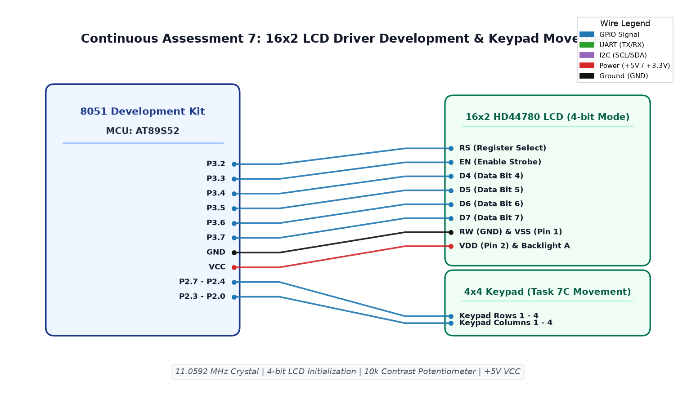

# CAT7 TASK7C: Keypad-Controlled LCD Character Cursor Navigation

**Course:** 25CS2741 Fundamentals of Internet of Things + Lab  
**Student:** Yazhini J E (Reg No: 25011102119)  
**Institution:** Shiv Nadar University Chennai  
**Date:** 24/08/2026  
**Platform:** 8051 Microcontroller (AT89S52)  
**Clock Frequency:** 11.0592 MHz  

---

## 1. Overview & Objectives
This experiment integrates a 4x4 matrix keypad with a 16x2 character LCD into an interactive game-like navigation system. A sprite character (`*`) displayed on the LCD grid is repositioned in real time using directional keypad presses:
- **Key `2`:** Move UP (Row 0)
- **Key `8`:** Move DOWN (Row 1)
- **Key `4`:** Move LEFT (Column - 1, constrained to `col >= 0`)
- **Key `6`:** Move RIGHT (Column + 1, constrained to `col <= 15`)

---

## 2. Screen Grid State Machine & Clipping
The sprite position is governed by coordinate pair `(curr_row, curr_col)`:
- When a valid direction key is detected, the old position is overwritten with an ASCII space `' '`.
- Boundary conditions:
  - If Key 4 and `curr_col > 0`: `curr_col--`
  - If Key 6 and `curr_col < 15`: `curr_col++`
  - If Key 2: `curr_row = 0`
  - If Key 8: `curr_row = 1`
- The sprite character `*` is printed at the updated location: `lcd_goto(curr_row, curr_col); lcd_data('*');`.

---

## 3. Circuit Schematic

---

## 4. Build, Flashing & Execution
1. Open `lcd.uvproj` in Keil µVision.
2. Build project to produce `Objects/lcd.hex`.
3. Flash the AT89S52; press keys 2, 8, 4, 6 on the matrix keypad to navigate the active cursor across the LCD.
