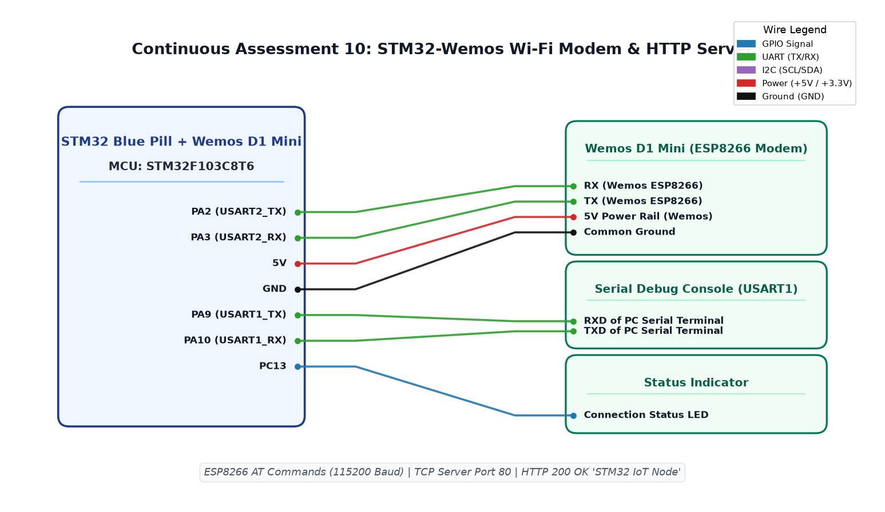

# EXPERIMENT DETAILS

**EXP:** CONTINUOUS ASSESSMENT 10  
**DATE:** 12/10/2026  
**NAME OF EXP:** STM32-Wemos Wi-Fi Modem Using AT Commands / HTTP Server  
**HARDWARE SETUP / PLATFORM:** STM32 Blue Pill (STM32F103C8T6) + Wemos D1 Mini (ESP8266) + Keil MDK-ARM + Serial Debugger + Web Browser / Node-RED  

---

## TASK 10A : STM32-Wemos UART Modem Interface and AT Command Bring-Up

### 1. Circuit Diagram
- **Development Board:** STM32 Blue Pill + Wemos D1 Mini
- **Microcontroller IC:** STM32F103C8T6 (ARM Cortex-M3)
- **Peripheral Pins:** 
  - `PA2` : USART2_TX -> RXD of ESP8266 / Wemos D1 Mini
  - `PA3` : USART2_RX -> TXD of ESP8266 / Wemos D1 Mini
  - `PA9` : USART1_TX -> RXD of PC Serial Console (Debug Monitor)
  - `PA10` : USART1_RX -> TXD of PC Serial Console (Debug Monitor)
  - `PC13` : Status Indicator LED
- **Peripherals:** Wemos D1 Mini (ESP8266 Wi-Fi module), USB-to-UART bridge
- **Power Supply:** 5V rail powering Wemos 5V pin, 3.3V powering STM32, common GND

### 2. Core Logic / Pseudocode / Code Base

**Working Principle:**  
The STM32 acts as the host controller while the Wemos D1 Mini (ESP8266) functions as a serial-to-Wi-Fi modem running standard Espressif AT firmware. Dual USART interfaces are employed: USART2 handles modem AT command transactions at 115200 baud, while USART1 routes diagnostic logging to a host PC terminal. Initial modem verification tests basic connectivity using `AT`, puts the station in client mode (`AT+CWMODE=1`), connects to a local wireless network (`AT+CWJAP`), and reads the assigned local IP address (`AT+CIFSR`).

**Pseudocode:**
1. Initialize USART1 (PC Debug at 115200 baud) and USART2 (Wemos Modem at 115200 baud).
2. Transmit `AT\r\n` over USART2; verify response contains `"OK"`.
3. Set Station mode: `AT+CWMODE=1\r\n`; await `"OK"`.
4. Connect to Wi-Fi access point: `AT+CWJAP="YOUR_WIFI_SSID","YOUR_WIFI_PASSWORD"\r\n`.
5. Query network configuration: `AT+CIFSR\r\n` to acquire station IP address.
6. Forward modem response packets to USART1 for visual confirmation on host console.

**Code Base:**
- `main.c` - Implements dual-UART pass-through, AT transmission, and Wi-Fi association sequence.
- Project folder: [`TASK_10A_AT_Commands`](TASK_10A_AT_Commands/)

### 3. INFERENCE
The STM32 reliably negotiated hardware handshakes with the ESP8266 over USART2. The Wi-Fi modem associated with the local wireless network and successfully obtained an IP address lease via DHCP.

---

## TASK 10C : Multi-Connection TCP Server Setup on Port 80

### 1. Circuit Diagram
- **Development Board:** STM32 Blue Pill + Wemos D1 Mini
- **Microcontroller IC:** STM32F103C8T6
- **GPIO / Peripheral Pins:** `PA2` (USART2_TX), `PA3` (USART2_RX), `PC13` (LED)
- **Peripherals:** Wemos D1 Mini, ST-Link V2
- **Power Supply:** 5V / 3.3V DC, Common GND

### 2. Core Logic / Pseudocode / Code Base

**Working Principle:**  
To accept incoming HTTP web requests, the ESP8266 modem is configured into multi-channel connection mode and bound to TCP port 80. The host STM32 issues `AT+CIPMUX=1` to allow up to 4 concurrent client sockets, followed by `AT+CIPSERVER=1,80` to activate the TCP listener. Once armed, the modem passively listens on the wireless interface for incoming TCP SYN packets from web clients.

**Pseudocode:**
1. Complete Wi-Fi station association (`AT+CWJAP`).
2. Issue `AT+CIPMUX=1\r\n` to enable multi-socket multiplexing.
3. Verify modem returns `"OK"`.
4. Issue `AT+CIPSERVER=1,80\r\n` to start TCP listener on port 80.
5. Verify server bind returns `"OK"`.
6. Enter listening loop to capture incoming client connection alerts.

**Code Base:**
- `main.c` - Implements TCP server configuration and socket multiplexing commands.
- Project folder: [`TASK_10C_TCP_Server`](TASK_10C_TCP_Server/)

### 3. INFERENCE
Enabling multi-connection mode (`CIPMUX=1`) is an indispensable prerequisite before establishing a server socket (`CIPSERVER=1,80`). The modem verified readiness to accept incoming HTTP socket requests on standard port 80.

---

## TASK 10D : HTTP Request Parsing (+IPD) and Dynamic HTTP 200 Response Server

### 1. Circuit Diagram
- **Development Board:** STM32 Blue Pill + Wemos D1 Mini
- **Microcontroller IC:** STM32F103C8T6
- **GPIO / Peripheral Pins:** `PA2` (USART2_TX), `PA3` (USART2_RX), `PC13` (Status LED)
- **Peripherals:** Wemos D1 Mini Wi-Fi module, PC Web Browser, Node-RED Dashboard
- **Power Supply:** 5V / 3.3V, Common GND

### 2. Core Logic / Pseudocode / Code Base

**Working Principle:**  
When an external HTTP client (browser or Node-RED HTTP request node) issues an HTTP GET request to the node's IP address, the ESP8266 routes the payload to the STM32 encapsulated within an `+IPD,<link_id>,<len>:<data>` frame. The STM32 parses the client link ID, crafts a compliant `HTTP/1.1 200 OK` header containing `Content-Length` and `Content-Type: text/html`, prepares an HTML payload (`<h1>STM32 IoT Node</h1>`), issues `AT+CIPSEND=<link_id>,<total_len>`, transmits the response string, and cleanly terminates the session with `AT+CIPCLOSE=<link_id>`.

**Pseudocode:**
1. In infinite listening loop:
   - Read incoming bytes from `huart2` into `rx_data` buffer.
   - Detect `+IPD` prefix indicating incoming client request frame.
   - Extract connection link identifier `link_id = rx_data[ipd_index + 5] - '0'`.
2. Construct HTML payload:
   `char response[] = "HTTP/1.1 200 OK\r\nContent-Type: text/html\r\nConnection: close\r\n\r\n<h1>STM32 IoT Node</h1>
Server is Running!
";`
3. Prepare send command: `sprintf(cmd, "AT+CIPSEND=%d,%d\r\n", link_id, (int)strlen(response));`.
4. Transmit `cmd` to modem; await `>` prompt character.
5. Transmit `response` string over `huart2`.
6. Issue close command: `sprintf(cmd, "AT+CIPCLOSE=%d\r\n", link_id);` to release socket resources.
7. Clear buffer and await next client connection.

**Code Base:**
- `main.c` - Complete HTTP web server implementation, frame parser, and socket manager.
- `Http response.ioc` - STM32CubeMX hardware configuration.
- Project folder: [`TASK_10D_HTTP_Response`](TASK_10D_HTTP_Response/)

### 3. INFERENCE
The STM32-based HTTP server successfully answered web requests originating from both Google Chrome and Node-RED HTTP nodes. The response rendered cleanly with HTTP status 200 OK, validating frame parsing and dynamic socket lifecycle handling.

