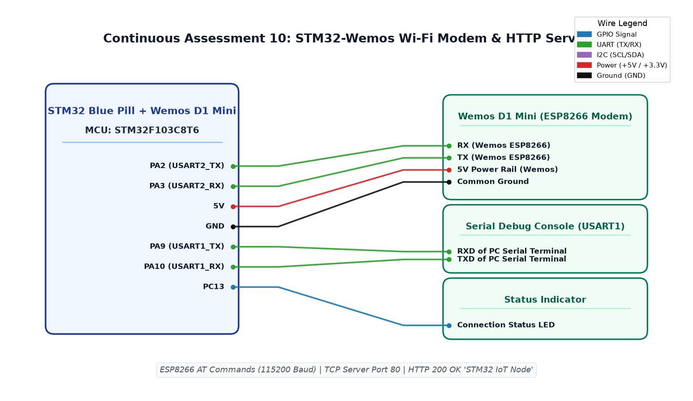

# CAT10 TASK10A: STM32 to ESP8266 AT Command Modem Bring-Up

**Course:** 25CS2741 Fundamentals of Internet of Things + Lab  
**Student:** Yazhini J E (Reg No: 25011102119)  
**Institution:** Shiv Nadar University Chennai  
**Date:** 12/10/2026  
**Platform:** STM32F103C8T6 + ESP8266 Wemos D1 Mini  
**Core Clock:** 72 MHz  

---

## 1. Overview & Objectives
This experiment brings up inter-chip UART communications between the STM32F103 host microcontroller and an ESP8266 Wemos D1 Mini Wi-Fi modem running standard Hayes AT firmware. The STM32 sends the basic attention command `AT\r\n` across `USART2` (`PA2`/`PA3`) and parses the modem's `OK` response to confirm functional hardware synchronization.

---

## 2. Hardware Pinout Table
| STM32 Pin | Function | ESP8266 Pin | Notes |
|---|---|---|---|
| **PA2** | USART2_TX | RX (GPIO3) | Transmit to ESP8266 |
| **PA3** | USART2_RX | TX (GPIO1) | Receive from ESP8266 |
| **3.3V / GND** | Power Supply | 3V3 / GND | Dedicated 3.3V regulator rail |

---

## 3. Circuit Schematic

---

## 4. Build, Flashing & Execution
1. Open `MDK-ARM/TASK_10A_AT_Commands.uvprojx` in Keil µVision.
2. Build and flash target firmware.
3. Observe debug console: STM32 transmits `AT\r\n`, receives `OK`, and illuminates status LED.
