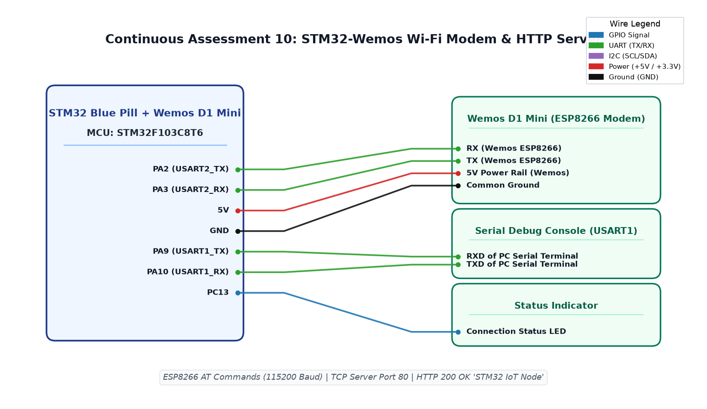

# CAT10 TASK10B: ESP8266 Station Mode Wi-Fi Join Controller

**Course:** 25CS2741 Fundamentals of Internet of Things + Lab  
**Student:** Yazhini J E (Reg No: 25011102119)  
**Institution:** Shiv Nadar University Chennai  
**Date:** 12/10/2026  
**Platform:** STM32F103C8T6 + ESP8266 Wemos D1 Mini  
**Core Clock:** 72 MHz  

---

## 1. Overview & Objectives
This experiment implements automated Wi-Fi station association through Hayes AT command sequencing. The STM32 initializes the ESP8266 into Station mode (`AT+CWMODE=1`), commands it to associate with the local Wi-Fi Access Point using sanitized credentials (`AT+CWJAP="YOUR_WIFI_SSID","YOUR_WIFI_PASSWORD"`), and queries the acquired local IP address using `AT+CIFSR`.

---

## 2. AT Command Handshake Sequence
1. `AT` -> Expect `OK`
2. `AT+CWMODE=1` -> Configures Wi-Fi Station Mode -> Expect `OK`
3. `AT+CWJAP="YOUR_WIFI_SSID","YOUR_WIFI_PASSWORD"` -> Joins Wi-Fi network -> Expect `WIFI CONNECTED` and `WIFI GOT IP`
4. `AT+CIFSR` -> Retrieves assigned IP and MAC address -> Parsed by STM32.

---

## 3. Circuit Schematic

---

## 4. Build, Flashing & Execution
1. Open `MDK-ARM/TASK_10B_WiFi_Join.uvprojx` in Keil µVision.
2. Build and flash target firmware.
3. Verify connection via serial log showing acquired IP address.
