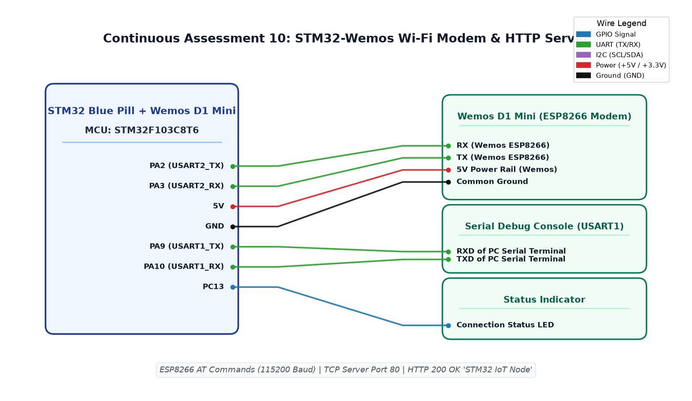

# CAT10 TASK10C: Embedded TCP/HTTP Server for Web-Based Actuator Control

**Course:** 25CS2741 Fundamentals of Internet of Things + Lab  
**Student:** Yazhini J E (Reg No: 25011102119)  
**Institution:** Shiv Nadar University Chennai  
**Date:** 12/10/2026  
**Platform:** STM32F103C8T6 + ESP8266 Wemos D1 Mini  
**Core Clock:** 72 MHz  

---

## 1. Overview & Objectives
This experiment designs an embedded web server hosted on the STM32 via the ESP8266 Wi-Fi modem. By configuring multiple IP connections (`AT+CIPMUX=1`) and starting a TCP server on port 80 (`AT+CIPSERVER=1,80`), web browsers can navigate to the assigned IP address to view a live HTML dashboard and control on-board actuators using HTTP GET endpoints (`/LED/ON`, `/LED/OFF`).

---

## 2. HTTP Request Handling & Response
Upon client connection (`+IPD,<id>,<len>:<request>`):
1. STM32 parses the requested path:
   - If `/LED/ON` -> Sets `PC13 = 0` (ON).
   - If `/LED/OFF` -> Sets `PC13 = 1` (OFF).
2. Transmits HTTP response via `AT+CIPSEND=<id>,<length>`:
   ```http
   HTTP/1.1 200 OK

   Content-Type: text/html


   <h1>STM32 Web Control</h1>
   <p><a href="/LED/ON"><button>ON</button></a></p>
   <p><a href="/LED/OFF"><button>OFF</button></a></p>
   ```
3. Closes connection via `AT+CIPCLOSE=<id>`.

---

## 3. Circuit Schematic


---

## 4. Build, Flashing & Execution
1. Open `MDK-ARM/TASK_10C_TCP_Server.uvprojx` in Keil µVision.
2. Build and flash the firmware.
3. Open a browser on the same Wi-Fi network and navigate to the STM32's IP; click buttons to toggle LED remotely.
