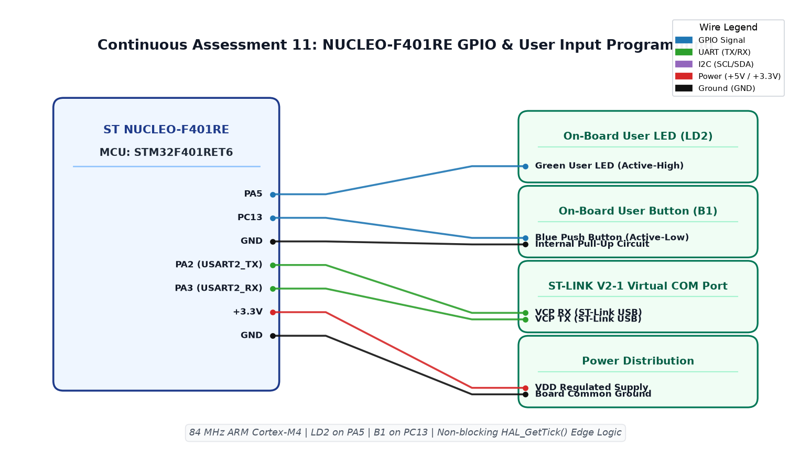

# EXPERIMENT DETAILS

**EXP:** CONTINUOUS ASSESSMENT 11  
**DATE:** 14/10/2026  
**NAME OF EXP:** STM32F401RE Cortex-M4: GPIO and User Input Programming  
**HARDWARE SETUP / PLATFORM:** ST NUCLEO-F401RE Board (ARM Cortex-M4 @ 84 MHz) + Keil MDK-ARM + On-Board Green LED (LD2 / PA5) + User Blue Button (B1 / PC13)  

---

## TASK 1 : Bare-Metal Blink of On-Board User LED (PA5)

### 1. Circuit Diagram
- **Development Board:** STMicroelectronics NUCLEO-F401RE
- **Microcontroller IC:** STM32F401RET6 (ARM 32-bit Cortex-M4 CPU with FPU, 84 MHz)
- **GPIO Pins:** 
  - `PA5` : GPIO Output Push-Pull (Connected to on-board Green LED LD2)
  - `PC13` : GPIO Input (Connected to on-board Blue User Button B1, active-LOW)
- **Peripherals:** Integrated on-board LD2 LED and B1 User Push Button
- **Power Supply:** Powered via ST-LINK V2-1 USB (+5V converted to +3.3V on-board)

### 2. Core Logic / Pseudocode / Code Base

**Working Principle:**  
The STM32F401RE high-performance Cortex-M4 MCU is configured via STM32CubeMX HAL. Pin PA5 is mapped as a push-pull digital output connected to the green user indicator (LD2). The CPU executes non-blocking state toggles using `HAL_GPIO_TogglePin()` paced by the millisecond SysTick counter (`HAL_GetTick()`), validating basic clock tree distribution and GPIO port bring-up.

**Pseudocode:**
1. Configure system clock to 84 MHz using the High-Speed Internal (HSI) oscillator and PLL in `SystemClock_Config()`.
2. In `MX_GPIO_Init()`:
   - Enable GPIOA clock: `__HAL_RCC_GPIOA_CLK_ENABLE()`.
   - Set `PA5` mode to `GPIO_MODE_OUTPUT_PP`, speed `GPIO_SPEED_FREQ_LOW`, no pull.
3. In main execution loop:
   - Check if `(HAL_GetTick() - blink_t) >= 500`.
   - Toggle pin: `HAL_GPIO_TogglePin(GPIOA, GPIO_PIN_5)`.
   - Update `blink_t = HAL_GetTick()`.

**Code Base:**
- `main.c` - Implements 84 MHz clock configuration, GPIO port initialization, and non-blocking LED toggling.
- `Led-Blink.ioc` - STM32CubeMX configuration file.
- Project folder: [`NUCLEO_GPIO_BringUp`](NUCLEO_GPIO_BringUp/)

### 3. INFERENCE
The Cortex-M4 microcontroller successfully energized on-board LED LD2. Operating under non-blocking tick timing yielded a symmetric 1 Hz flash rate without wasting CPU execution cycles in blocking wait loops.

---

## TASK 2 : User Push Button (PC13) State Latching and Debouncing

### 1. Circuit Diagram
- **Development Board:** ST NUCLEO-F401RE
- **Microcontroller IC:** STM32F401RET6
- **GPIO Pins:** `PA5` (LD2 Green LED Output), `PC13` (B1 User Button Input)
- **Peripherals:** On-board LD2 and B1 push button
- **Power Supply:** +3.3V VDD, GND

### 2. Core Logic / Pseudocode / Code Base

**Working Principle:**  
Pin PC13 connects to the on-board blue tactile button B1, which reads HIGH (1) when idle and transitions to LOW (0) when pressed against ground. An edge-detection algorithm monitors state transitions between successive iterations. When a falling edge transition is validated through a 30 ms debounce filter, the system inverts the registered state of LD2, latching the LED state across releases.

**Pseudocode:**
1. Initialize variables `prev = GPIO_PIN_SET` and `press_t = 0`.
2. In `while (1)` loop:
   - Read current button state `cur = HAL_GPIO_ReadPin(GPIOC, GPIO_PIN_13)`.
   - Fetch `now = HAL_GetTick()`.
   - Detect press event (`prev == SET && cur == RESET`): store start time `press_t = now`.
   - Detect release event (`prev == RESET && cur == SET`):
     - If contact closure duration `(now - press_t) >= 30 ms`, toggle `HAL_GPIO_TogglePin(GPIOA, GPIO_PIN_5)`.
   - Update `prev = cur`.

**Code Base:**
- `main.c` - Implements edge-triggered switch event capture, contact debounce, and persistent state latching.
- Project folder: [`NUCLEO_GPIO_BringUp`](NUCLEO_GPIO_BringUp/)

### 3. INFERENCE
Mechanical contact bounce was completely filtered by the 30 ms threshold window. The LED toggled and retained its state with 100% repeatability upon each physical button release.

---

## TASK 3 : Short Press vs Long Press Event Discrimination

### 1. Circuit Diagram
- **Development Board:** ST NUCLEO-F401RE
- **Microcontroller IC:** STM32F401RET6
- **GPIO Pins:** `PA5` (Output, LD2), `PC13` (Input, B1 Button)
- **Peripherals:** On-board push button and LED
- **Power Supply:** +3.3V VDD, GND

### 2. Core Logic / Pseudocode / Code Base

**Working Principle:**  
Advanced user interface design on single-button embedded devices relies on duration-sensitive input decoding. By comparing the button release timestamp with the initial actuation moment, Task 3 identifies two distinct operational events:
1. **Short Tap ($30 \text{ ms} \le \Delta t < 500 \text{ ms}$):** Inverts and latches the static ON/OFF state of LD2.
2. **Long Hold ($\Delta t \ge 500 \text{ ms}$):** Activates an automatic rapid blinking mode (200 ms period) to signal an alert state. A subsequent tap cancels the alert mode and restores manual control.

**Pseudocode:**
1. Declare state flags `blink = 0`, `blink_t = 0`, `press_t = 0`, `prev = SET`.
2. In main loop:
   - Sample `cur = HAL_GPIO_ReadPin(GPIOC, GPIO_PIN_13)` and `now = HAL_GetTick()`.
   - On falling edge: set `press_t = now`.
   - On rising edge:
     - If `(now - press_t) >= 500`: toggle `blink = !blink` (Long Press Mode).
     - Else if `(now - press_t) >= 30`:
       - If `blink` mode is active, disengage `blink = 0`.
       - Else, toggle `HAL_GPIO_TogglePin(GPIOA, GPIO_PIN_5)`.
   - If `blink == 1` and `(now - blink_t) >= 200`:
     - Toggle `PA5` output.
     - Reset `blink_t = now`.
   - Update `prev = cur`.

**Code Base:**
- `main.c` - Implements dual-threshold duration classifier and concurrent non-blocking blink scheduler.
- Project folder: [`NUCLEO_GPIO_BringUp`](NUCLEO_GPIO_BringUp/)

### 3. INFERENCE
The duration discriminator reliably differentiated between quick taps and sustained holds. Combining edge timestamps with non-blocking timing enabled smooth multi-mode behavior without UI freezing or missed events.

