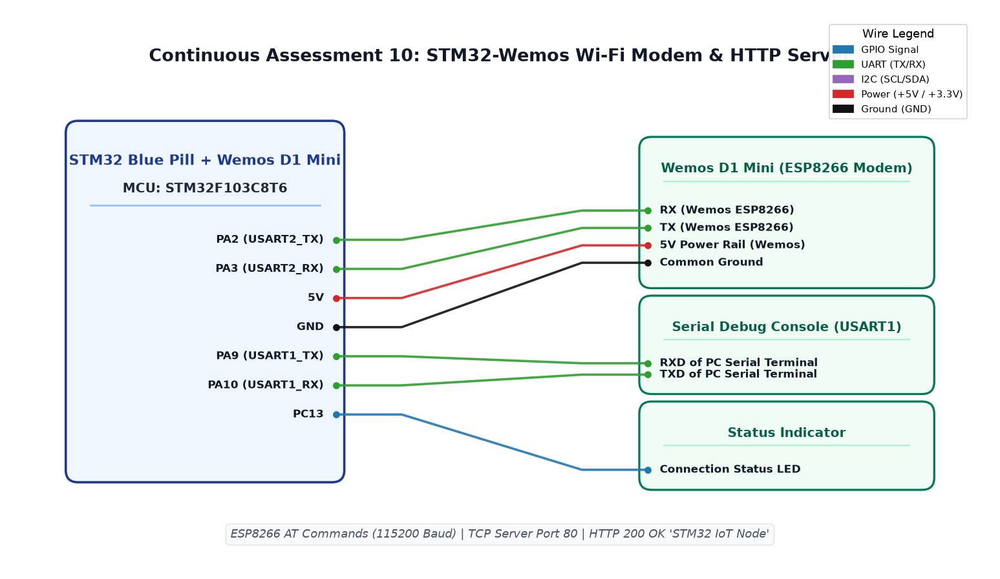

# TASK 11A – TCP Server Setup, IP Retrieval and +IPD Reception

## Experiment Details

| Field | Details |
|---|---|
| **Experiment** | Continuous Assessment 11 |
| **Date** | 22/10/2026 |
| **Title** | HTTP Server – STM32–Wemos Wi-Fi Modem Using AT Commands |
| **Platform** | STM32F103C8T6 Blue Pill + Wemos D1 Mini (ESP8266) |
| **IDE** | STM32CubeMX + Keil MDK-ARM |

## Aim

Configure the ESP8266 in station mode via USART2 AT commands, connect to a Wi-Fi network, retrieve the assigned IP address, start a TCP server on port 80, receive incoming `+IPD` client requests and respond with a dynamic HTTP webpage.

## Required Hardware and Software

### Hardware

- STM32F103C8T6 Blue Pill development board
- Wemos D1 Mini (ESP8266)
- USB-to-Serial adapter / ST-Link V2 programmer
- Breadboard and jumper wires
- 3.3 V power supply (common ground)

### Software

- STM32CubeMX 6.18.1
- Keil MDK-ARM V5.32
- STM32Cube FW_F1 V1.8.7
- Serial monitor (Tera Term / PuTTY)
- Web browser for HTTP testing

## Pin Connections

| STM32 Pin | Function | Connected To |
|---|---|---|
| PA2 | USART2_TX | ESP8266 RX |
| PA3 | USART2_RX | ESP8266 TX |
| PD0 | OSC_IN | 8 MHz HSE Crystal |
| PD1 | OSC_OUT | 8 MHz HSE Crystal |
| PA13 | SWDIO | ST-Link (debug) |
| PA14 | SWCLK | ST-Link (debug) |
| GND | Ground | ESP8266 GND |
| 3.3V | Power | ESP8266 3V3 |



## UART Configuration

| Parameter | Value |
|---|---|
| Peripheral | USART2 |
| Baud Rate | 115200 |
| Word Length | 8 bits |
| Stop Bits | 1 |
| Parity | None |
| Flow Control | None |

## Clock Configuration

- HSE: 8 MHz external crystal (PD0/PD1)
- PLL multiplier: x9
- SYSCLK: 72 MHz
- APB1: 36 MHz (div 2)
- APB2: 72 MHz (div 1)

## Working Principle

1. The STM32 communicates with the ESP8266 through USART2 at 115200 baud using AT commands.
2. A startup sequence configures station mode, connects to Wi-Fi, retrieves the IP address, enables multi-connection mode and starts a TCP server on port 80.
3. In the main loop, the STM32 continuously polls UART for incoming bytes.
4. When the ESP8266 receives a client connection, it sends a `+IPD,<conn_id>,<length>:<data>` message through UART.
5. The firmware detects the `+IPD,` marker and the `GET /` HTTP request within the received data.
6. It extracts the connection ID from the `+IPD` header.
7. It builds an HTTP 200 response containing a dynamic HTML page with an incrementing counter.
8. It sends the response using `AT+CIPSEND=<conn_id>,<length>` and then closes the connection with `AT+CIPCLOSE=<conn_id>`.

## AT Command Sequence (Initialization)

| Step | Command | Purpose |
|---|---|---|
| 1 | `AT` | Test ESP8266 communication |
| 2 | `AT+CWMODE=1` | Set station mode |
| 3 | `AT+CWJAP="SSID","PASSWORD"` | Connect to Wi-Fi network |
| 4 | `AT+CIFSR` | Retrieve assigned IP address |
| 5 | `AT+CIPMUX=1` | Enable multiple connections |
| 6 | `AT+CIPSERVER=1,80` | Start TCP server on port 80 |

## Implementation Details

### Buffer Management

- `rx_data[800]`: UART receive buffer (800 bytes)
- `array_index`: Current write position in the buffer
- `clear_buffer()`: Zeros the buffer and resets `array_index` using `memset()`
- Buffer overflow protection: resets buffer when `array_index >= sizeof(rx_data) - 1`

### Response Reception (`receive_response()`)

Collects UART bytes one at a time with a 20-second timeout. Breaks on:
- `"OK"` — command succeeded
- `"ERROR"` or `"FAIL"` — command failed
- `">"` — ESP8266 ready for data transmission
- UART timeout — no more data available

### +IPD Parsing (Main Loop)

```c
if (strstr((char *)rx_data, "+IPD,") != NULL &&
    strstr((char *)rx_data, "GET /") != NULL)
{
    char *ipd_ptr = strstr((char *)rx_data, "+IPD,");
    int conn_id = ipd_ptr[5] - '0';
    send_http_response(conn_id);
    clear_buffer();
}
```

- Detects `+IPD,` to identify incoming client data
- Checks for `GET /` to confirm it is an HTTP request
- Extracts the single-digit connection ID from position `+IPD,X`
- Calls `send_http_response(conn_id)` with the extracted ID

### HTTP Response (`send_http_response()`)

1. Increments the global `counter` variable.
2. Builds an HTML body: `<html><body><h1>New num X</h1></body></html>`
3. Constructs the full HTTP response with headers (200 OK, Content-Type, Content-Length, Connection: close).
4. Sends `AT+CIPSEND=<conn_id>,<length>` and waits for the `>` prompt.
5. Transmits the HTTP response data.
6. Closes the connection with `AT+CIPCLOSE=<conn_id>`.

## Expected Serial Monitor Output

```
AT
OK
AT+CWMODE=1
OK
AT+CWJAP="YourSSID","YourPassword"
WIFI CONNECTED
WIFI GOT IP
OK
AT+CIFSR
+CIFSR:STAIP,"192.168.x.x"
+CIFSR:STAMAC,"xx:xx:xx:xx:xx:xx"
OK
AT+CIPMUX=1
OK
AT+CIPSERVER=1,80
OK

0,CONNECT
+IPD,0,xxx:GET / HTTP/1.1...
AT+CIPSEND=0,xxx
> (HTTP response sent)
SEND OK
AT+CIPCLOSE=0
0,CLOSED
```

## Expected Browser Output

Navigate to `http://192.168.x.x` (the IP reported by `AT+CIFSR`):

```
New num 1
```

Each page refresh increments the counter:

```
New num 2
```

## Troubleshooting

| Issue | Solution |
|---|---|
| ESP8266 does not respond to `AT` | Check TX/RX wiring (PA2?ESP RX, PA3?ESP TX). Verify 3.3 V power and common ground. |
| `AT+CWJAP` returns `FAIL` | Verify Wi-Fi SSID and password. Ensure the network is 2.4 GHz. |
| `AT+CIFSR` returns `0.0.0.0` | Wi-Fi connection not established. Re-send `AT+CWJAP`. |
| Browser cannot connect | Verify the IP address. Ensure STM32 and browser are on the same network. |
| `+IPD` not detected | Check that `AT+CIPMUX=1` and `AT+CIPSERVER=1,80` returned `OK`. |
| Buffer overflow | The 800-byte buffer resets automatically when full. Reduce request frequency if needed. |
| No HTTP response | Check that `AT+CIPSEND` receives the `>` prompt before sending data. |

## Result

The STM32 successfully initializes the ESP8266 as a Wi-Fi station, connects to the network, retrieves the IP address, starts a TCP server on port 80, receives incoming HTTP GET requests via `+IPD` parsing, and responds with a dynamic HTML page displaying an incrementing counter. Each browser request receives a valid HTTP 200 response with the updated counter value.