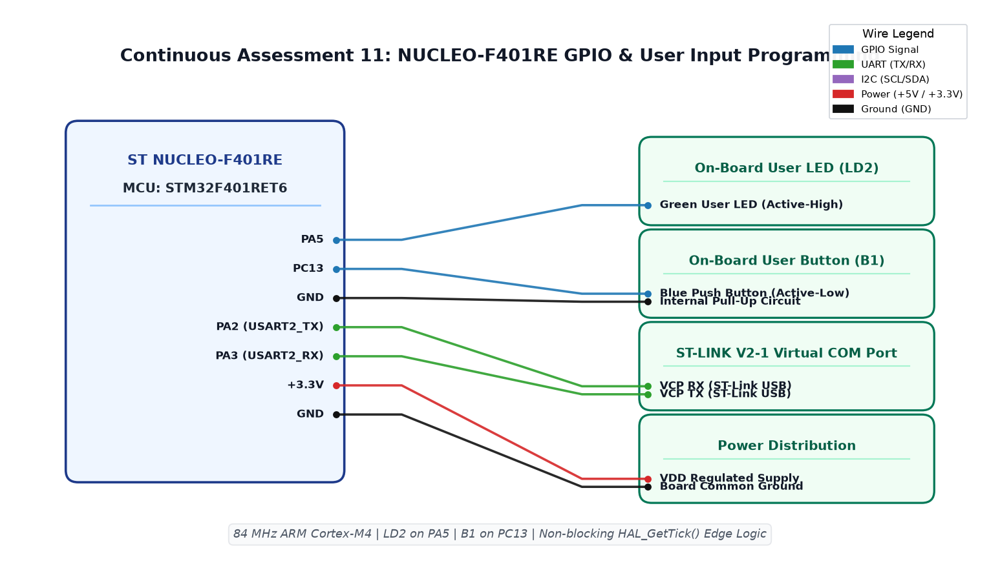

# CAT11 TASK11B: NUCLEO User Push-Button (B1 / PC13) Interrupt & State Toggle

**Course:** 25CS2741 Fundamentals of Internet of Things + Lab  
**Student:** Yazhini J E (Reg No: 25011102119)  
**Institution:** Shiv Nadar University Chennai  
**Date:** 19/10/2026  
**Platform:** STM32 NUCLEO-F401RE / STM32F103C8T6  
**Core Clock:** 84 MHz / 72 MHz  

---

## 1. Overview & Objectives
This experiment configures the blue user push-button (B1 on `PC13`) as an external interrupt / event input with internal pull-up and software debouncing. Each falling-edge transition toggles the user LED on `PA5`, sending telemetry status updates across the ST-LINK Virtual COM port over USART2.

---

## 2. Hardware Pinout Table
| Board Pin | Peripheral Connection | Function |
|---|---|---|
| **PC13** | Blue Push-Button (B1) | Active-Low Input with EXTI13 / Debounce |
| **PA5** | User LED (LD2) | Digital Output Indicator |
| **PA2 / PA3** | USART2_TX / RX | ST-LINK VCP Debug Telemetry |

---

## 3. Circuit Schematic

---

## 4. Build, Flashing & Execution
1. Open `MDK-ARM/Led-Blink.uvprojx` in Keil µVision.
2. Build and flash the firmware.
3. Press button B1; verify immediate LED toggle and serial confirmation.
