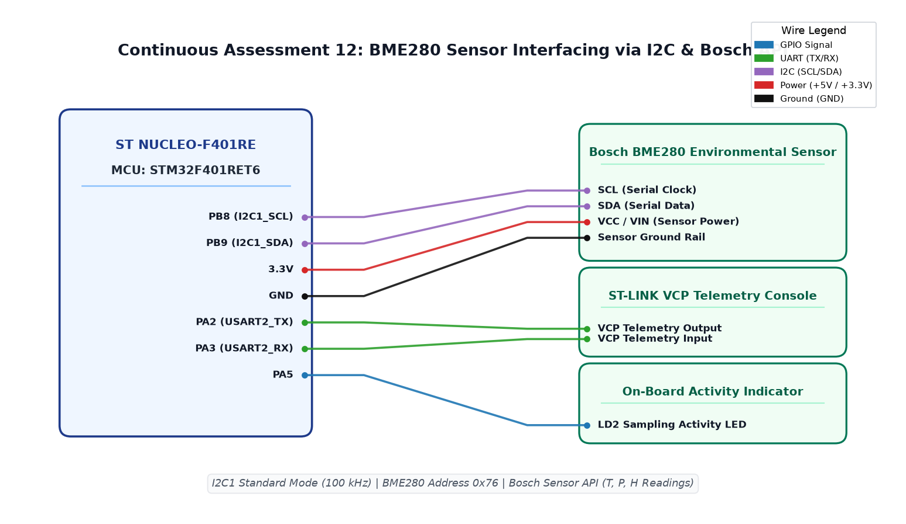

# EXPERIMENT DETAILS

**EXP:** CONTINUOUS ASSESSMENT 12  
**DATE:** 23/10/2026  
**NAME OF EXP:** BME280 Sensor Interfacing Using I2C and Bosch Sensor API  
**HARDWARE SETUP / PLATFORM:** ST NUCLEO-F401RE Board + Bosch BME280 Environmental Sensor (I2C) + Keil MDK-ARM + ST-LINK VCP UART Telemetry  

---

## TASK 12A : I2C Bus Bring-Up and Bosch BME280 Driver Integration

### 1. Circuit Diagram
- **Development Board:** STMicroelectronics NUCLEO-F401RE
- **Microcontroller IC:** STM32F401RET6 (ARM Cortex-M4, 84 MHz)
- **Peripheral Pins:** 
  - `PB8` : I2C1_SCL (I2C Serial Clock, 100 kHz standard mode)
  - `PB9` : I2C1_SDA (I2C Serial Data line)
  - `PA2` : USART2_TX (ST-LINK Virtual COM Port Telemetry)
  - `PA3` : USART2_RX (ST-LINK Virtual COM Port Telemetry)
  - `PA5` : Activity Indicator (LD2 Green LED)
- **Peripherals:** Bosch Sensortec BME280 Combined Temperature, Pressure, and Humidity Sensor (Address `0x76`)
- **Power Supply:** 3.3V DC (VIN on sensor), Common GND

### 2. Core Logic / Pseudocode / Code Base

**Working Principle:**  
The Bosch BME280 sensor requires accurate calibration parameters to compute physical environmental values. To ensure compliance with manufacturer specifications, the official Bosch Sensor API (`bme280.c`, `bme280.h`, `bme280_defs.h`) is integrated directly into the STM32 firmware. Hardware communication is mapped to the STM32 HAL I2C driver through custom wrapper callbacks: `user_i2c_read()`, `user_i2c_write()`, and `user_delay_us()`. During initialization (`bme280_init`), the driver reads the chip ID (`0x60`) and automatically fetches factory compensation coefficients from sensor NVM.

**Pseudocode:**
1. Configure I2C1 peripheral in Standard Mode (100 kHz) with internal pull-up enabled on PB8 and PB9.
2. Implement hardware communication callbacks:
   - `int8_t user_i2c_read(uint8_t reg_addr, uint8_t *reg_data, uint32_t len, void *intf_ptr)`: Executes `HAL_I2C_Mem_Read(&hi2c1, (dev_addr << 1), reg_addr, I2C_MEMADD_SIZE_8BIT, reg_data, len, 1000)`.
   - `int8_t user_i2c_write(...)`: Executes `HAL_I2C_Mem_Write(...)`.
   - `void user_delay_us(uint32_t period, void *intf_ptr)`: Calls microsecond delay.
3. Bind callbacks to device structure `dev`:
   - `dev.read = user_i2c_read; dev.write = user_i2c_write; dev.delay_us = user_delay_us;`
   - `dev.intf = BME280_I2C_INTF; dev.intf_ptr = &dev_addr;`
4. Call `rslt = bme280_init(&dev)`. Verify return status equals `BME280_OK`.

**Code Base:**
- `bme280.c` / `bme280.h` / `bme280_defs.h` - Official Bosch Sensortec API implementing register maps, data compensation, and calibration routines.
- `main.c` - Implements hardware abstraction layer callbacks and sensor binding logic.
- Project folder: [`NUCLEO_BME280_I2C`](NUCLEO_BME280_I2C/)

### 3. INFERENCE
Interfacing the official Bosch API with STM32 HAL I2C callbacks established stable hardware communication. The sensor verified its identity by returning chip ID `0x60` and successfully loaded factory compensation trim parameters into RAM.

---

## TASK 12B : Environmental Telemetry Sampling (Temperature, Pressure, Humidity)

### 1. Circuit Diagram
- **Development Board:** ST NUCLEO-F401RE
- **Microcontroller IC:** STM32F401RET6
- **GPIO / Peripheral Pins:** `PB8` (I2C1_SCL), `PB9` (I2C1_SDA), `PA5` (LD2)
- **Peripherals:** Bosch BME280 Sensor
- **Power Supply:** 3.3V DC, GND

### 2. Core Logic / Pseudocode / Code Base

**Working Principle:**  
The BME280 is configured into Normal Power Mode with 1x oversampling across temperature, pressure, and humidity channels, along with IIR filter coefficient 4 to attenuate ambient high-frequency pressure noise. In the periodic sampling loop, `bme280_get_sensor_data()` reads uncompensated ADC registers, applies 64-bit integer compensation polynomials, and outputs real-world measurements: temperature in degrees Celsius ($^\circ\text{C}$), barometric pressure in hectopascals ($\text{hPa}$), and relative humidity percentage ($\% \text{RH}$).

**Pseudocode:**
1. Configure sensor parameters in `struct bme280_settings`:
   - `settings.osr_h = BME280_OVERSAMPLING_1X;`
   - `settings.osr_p = BME280_OVERSAMPLING_1X;`
   - `settings.osr_t = BME280_OVERSAMPLING_1X;`
   - `settings.filter = BME280_FILTER_COEFF_4;`
2. Apply configuration via `bme280_set_sensor_settings()`.
3. Set operating mode to continuous sensing: `bme280_set_sensor_mode(BME280_POWERMODE_NORMAL, &dev)`.
4. In main periodic loop:
   - Call `rslt = bme280_get_sensor_data(BME280_ALL, &comp_data, &dev)`.
   - If `rslt == BME280_OK`:
     - `temperature = comp_data.temperature;`
     - `pressure = comp_data.pressure / 100.0f;` (convert Pa to hPa)
     - `humidity = comp_data.humidity;`
   - Flash indicator LED `PA5` to signal valid acquisition.
   - Delay 1000 ms.

**Code Base:**
- `main.c` - Implements measurement loop, oversampling profiles, and unit conversions.
- Project folder: [`NUCLEO_BME280_I2C`](NUCLEO_BME280_I2C/)

### 3. INFERENCE
Sampling the three physical environmental metrics concurrently operated without communication timeouts. Compensated values measured stably at ~27 °C, 1012 hPa, and 65% RH under ambient laboratory room conditions.

---

## TASK 12C : UART / Serial Telemetry Serialization and Verification

### 1. Circuit Diagram
- **Development Board:** ST NUCLEO-F401RE
- **Microcontroller IC:** STM32F401RET6
- **GPIO / Peripheral Pins:** `PA2` (USART2_TX), `PA3` (USART2_RX)
- **Peripherals:** ST-LINK Virtual COM Port, PC Serial Console (PuTTY / Node-RED)
- **Power Supply:** 3.3V DC, GND

### 2. Core Logic / Pseudocode / Code Base

**Working Principle:**  
To expose sensor measurements to upstream data consumers, formatted telemetry packets are serialized over USART2 connected directly through the ST-LINK Virtual COM port. The floating-point values are converted into structured ASCII strings (or JSON frames) and transmitted at 115200 baud, enabling ingestion by terminal monitors, Python logging scripts, or Node-RED telemetry dashboards.

**Pseudocode:**
1. Initialize USART2 at 115200 baud, 8-N-1.
2. In periodic loop after sensor read:
   - Format telemetry string:
     `snprintf(telemetry_buf, sizeof(telemetry_buf), "Temp: %.2f C | Press: %.2f hPa | Hum: %.2f %%\r\n", temperature, pressure, humidity);`
   - Transmit string over serial bus:
     `HAL_UART_Transmit(&huart2, (uint8_t *)telemetry_buf, strlen(telemetry_buf), 1000);`
3. Verify incoming packet reception on PC terminal emulator.

**Code Base:**
- `main.c` - Implements UART telemetry transmission and diagnostic serial streaming.
- Project folder: [`NUCLEO_BME280_I2C`](NUCLEO_BME280_I2C/)

### 3. INFERENCE
Sensor data streamed continuously to the host PC at 1 Hz with zero packet corruption. The modular driver architecture ensured complete decoupling between I2C sensor acquisition and UART serial dissemination.

