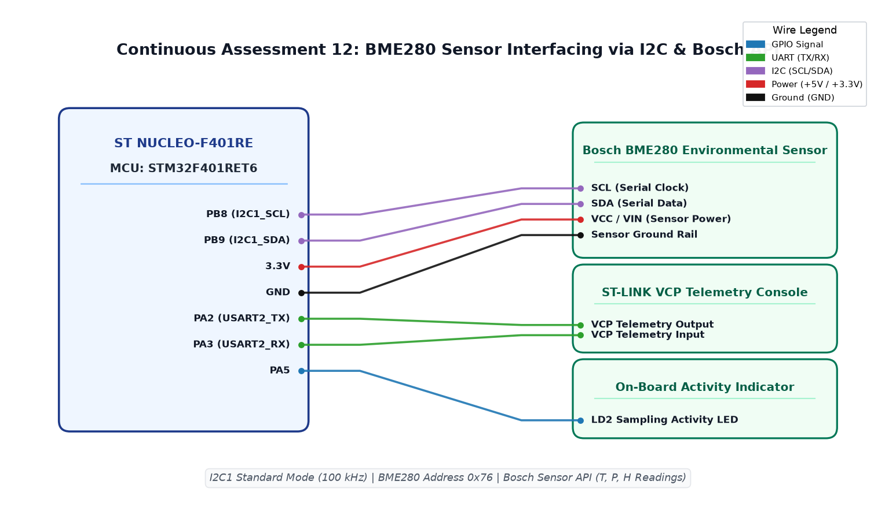

# CAT12 TASK12A: I2C Master Bus Bring-Up & Device Address Scanner

**Course:** 25CS2741 Fundamentals of Internet of Things + Lab  
**Student:** Yazhini J E (Reg No: 25011102119)  
**Institution:** Shiv Nadar University Chennai  
**Date:** 26/10/2026  
**Platform:** STM32 NUCLEO-F401RE / STM32F103C8T6  
**Core Clock:** 84 MHz  

---

## 1. Overview & Objectives
This experiment implements an automated I2C bus scanner on the STM32 platform. Operating the `I2C1` peripheral at Standard Mode (100 kHz), the firmware probes all 7-bit addresses (0x01 to 0x77) using `HAL_I2C_IsDeviceReady()`. Detected slave devices (such as the Bosch BME280 sensor at `0x76` or `0x77`) are logged to the host serial console.

---

## 2. I2C Bus Pin Mapping
| Signal | STM32 Pin | Sensor Pin | Pull-Up Configuration |
|---|---|---|---|
| **I2C1_SCL** | `PB8` / `PB6` | SCL | 4.7 kΩ Pull-up to 3.3V |
| **I2C1_SDA** | `PB9` / `PB7` | SDA | 4.7 kΩ Pull-up to 3.3V |
| **VCC / GND** | 3.3V / GND | VIN / GND | Power supply rails |

---

## 3. Circuit Schematic

---

## 4. Build, Flashing & Execution
1. Open `MDK-ARM/MQTT.uvprojx` in Keil µVision.
2. Build and flash target firmware.
3. Open serial console at 115200 baud; observe I2C scan report identifying device at `0x76`.
