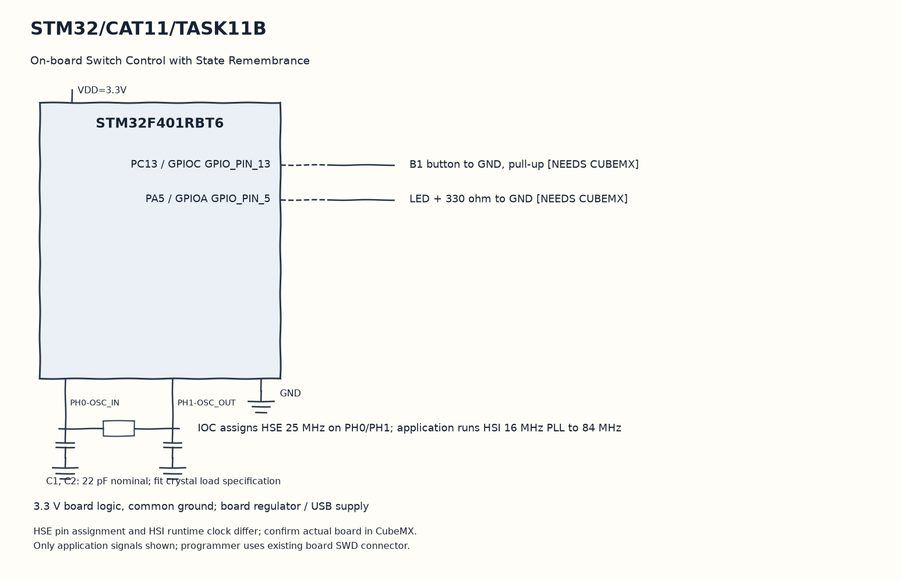

EXPERIMENT DETAILS
EXP: CONTINUOUS ASSESSMENT 12
DATE: 14/10/2026
NAME OF EXP: STM32F401RE Cortex-M4: GPIO and User Input Programming
HARDWARE SETUP / PLATFORM: STM32F401RB development board (physical board unconfirmed) + STM32F401RBT6 + GPIO LED and input + STM32CubeMX (MDK-ARM project)
TASK 12B : On-board Switch Control with State Remembrance

1. Circuit Diagram
On release, toggle PA5 and preserve that output until the next event to demonstrate 12B with the shown signals.

* Microcontroller / Board: STM32F401RB development board (physical board unconfirmed) + STM32F401RBT6.
* GPIO / Peripheral pins: PC13 / GPIOC GPIO_PIN_13 -> B1 button to GND, pull-up; PA5 / GPIOA GPIO_PIN_5 -> LED + 330 ohm to GND.
* Clock: HSI 16 MHz PLL to 84 MHz.
* External components / Peripheral: B1 button to GND, pull-up; LED + 330 ohm to GND.
* Power Supply: 3.3 V board logic, common ground; board regulator / USB supply.

2. Core Logic / Pseudocode / Code Base
Working Principle: PC13 transitions are filtered with a twenty-millisecond tick comparison. A stable release toggles PA5 once and the output latch remembers the state, with both application GPIO settings now configured.

Pseudocode:

1. Read the intended PC13 button input.
2. Track raw changes and accept a stable level after twenty milliseconds.
3. Record the press timestamp.
4. On release, toggle PA5 and preserve that output until the next event.

Code Base:
The program is written in Embedded C using STM32 HAL (STM32CubeMX).

* `main.h` provides the project HAL declarations in this program.
* `HAL_GetTick()` returns the millisecond time used for event comparisons here.
* `HAL_GPIO_ReadPin()` reads the application switch level here.
* `HAL_GPIO_TogglePin()` changes the stored LED output state here.

3. Inference
The prepared loop gives one remembered LED change per completed press. The source demonstrates event state handling with GPIO configuration corrected; hardware testing remains pending.

Configuration correction: PA5 push-pull output, initial LOW, PC13 input with pull-up (active LOW assumed). The existing STM32F401RB target is retained until the actual board is confirmed; if using NUCLEO-F401RE, migrate the project to that target in CubeMX/Keil. No target build or hardware test performed.
