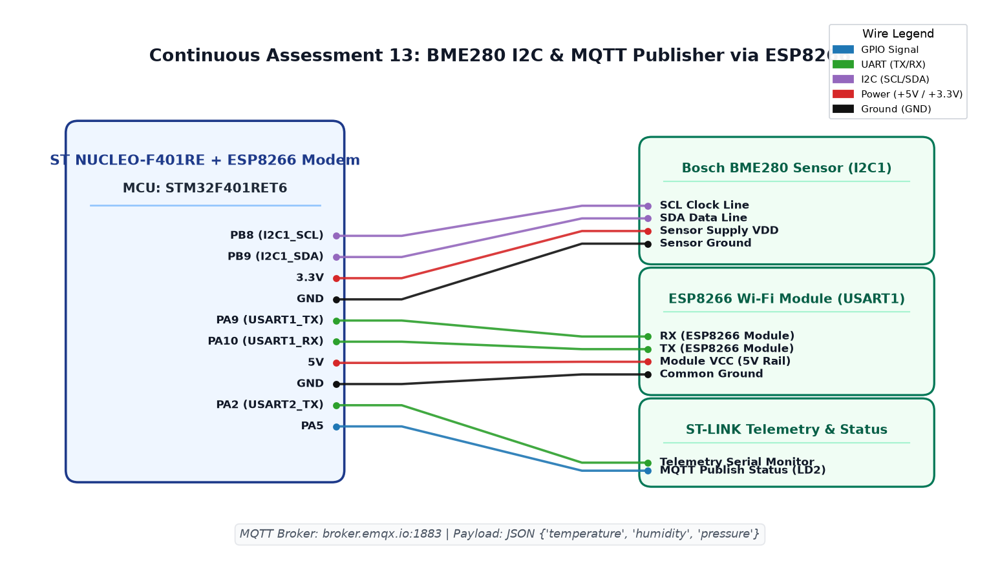

# EXPERIMENT DETAILS

**EXP:** CONTINUOUS ASSESSMENT 13  
**DATE:** 27/10/2026  
**NAME OF EXP:** BME280 Sensor Interfacing Using I2C and MQTT using Custom Built ESP8266 API  
**HARDWARE SETUP / PLATFORM:** ST NUCLEO-F401RE Board + Bosch BME280 Sensor (I2C) + ESP8266 Wi-Fi Module (USART1) + Keil MDK-ARM + Public MQTT Broker (`broker.emqx.io:1883`) + Node-RED Dashboard  

---

## TASK 13A : Custom ESP8266 MQTT Driver Architecture (ESPLib)

### 1. Circuit Diagram
- **Development Board:** STMicroelectronics NUCLEO-F401RE + Wemos D1 Mini / ESP8266
- **Microcontroller IC:** STM32F401RET6 (ARM Cortex-M4, 84 MHz)
- **Peripheral Pins:** 
  - `PB8` : I2C1_SCL (BME280 Clock)
  - `PB9` : I2C1_SDA (BME280 Data)
  - `PA9` : USART1_TX -> RXD of ESP8266 Wi-Fi Module
  - `PA10` : USART1_RX -> TXD of ESP8266 Wi-Fi Module
  - `PA5` : Status Indicator LED (LD2)
- **Peripherals:** Bosch BME280 Sensor, ESP8266 Wi-Fi SoC running standard AT firmware
- **Power Supply:** +5V rail for ESP8266, +3.3V for STM32 and BME280, Common Ground



### 2. Core Logic / Pseudocode / Code Base

**Working Principle:**  
To publish lightweight telemetry to cloud IoT platforms, a custom driver library (`ESPLib.c` / `ESPLib.h`) encapsulates low-level AT modem handshakes into high-level networking APIs: `ESP8266_Init()`, `ESP8266_wifiConnect()`, `ESP8266_portConnect()`, and `MQTT_connectBroker()`. The library establishes a TCP socket connection directly to the public EMQX MQTT broker (`broker.emqx.io` on port 1883) and completes the standard MQTT `CONNECT` packet handshake.

**Pseudocode:**
1. Initialize USART1 peripheral at 115200 baud for modem communication.
2. Call `ESP8266_Init(StationMode, huart1)` to reset modem and select station role.
3. Call `ESP8266_wifiConnect("YOUR_WIFI_SSID", "YOUR_WIFI_PASSWORD")` to associate with local Wi-Fi.
4. Establish TCP socket: `ESP8266_portConnect("TCP", "broker.emqx.io", "1883")`.
5. Configure MQTT client credentials:
   - Client ID: `"STM32_BME280_Publisher"`
   - KeepAlive interval: `500` seconds
   - Clean Session flag: `1`
6. Transmit MQTT `CONNECT` packet via `MQTT_connectBroker(&mqttSetting)` and verify `CONNACK` response.

**Code Base:**
- `ESPLib.c` / `ESPLib.h` - Custom-built ESP8266 modem library handling AT commands, TCP sockets, and MQTT framing.
- `main.c` - Implements network initialization sequence and MQTT broker connection logic.
- Project folder: [`NUCLEO_BME280_ESP8266_MQTT`](NUCLEO_BME280_ESP8266_MQTT/)

### 3. INFERENCE
Encapsulating modem transactions into the `ESPLib` driver provided a clean, robust abstraction layer. The STM32 successfully negotiated a persistent TCP connection to `broker.emqx.io:1883` and received a valid MQTT `CONNACK`.

---

## TASK 13B : Structured JSON Environmental Telemetry Construction

### 1. Circuit Diagram
- **Development Board:** ST NUCLEO-F401RE + ESP8266
- **Microcontroller IC:** STM32F401RET6
- **GPIO / Peripheral Pins:** `PB8` (I2C1_SCL), `PB9` (I2C1_SDA), `PA9` (USART1_TX), `PA10` (USART1_RX)
- **Peripherals:** Bosch BME280 Sensor, ESP8266 Wi-Fi Module
- **Power Supply:** 5V / 3.3V DC, Common GND


### 2. Core Logic / Pseudocode / Code Base

**Working Principle:**  
Interoperable IoT data architectures require self-describing, standard data serialization. Environmental readings acquired via the Bosch Sensortec API are formatted into a minified JSON document containing temperature, barometric pressure, and relative humidity keys. Using safe string formatting (`snprintf`), the payload size is bounded within a 160-byte buffer to avoid stack overflows.

**JSON Payload Format:**
```json
{
  "temperature": 27.45,
  "pressure_hpa": 1012.30,
  "humidity": 65.20
}
```

**Pseudocode:**
1. Acquire compensated sensor readings using `bme280_get_sensor_data(BME280_ALL, &sensor_data, &bme)`.
2. Extract floating-point parameters:
   - `temperature_c = (float)sensor_data.temperature;`
   - `pressure_hpa = (float)(sensor_data.pressure / 100.0);`
   - `humidity_pct = (float)sensor_data.humidity;`
3. Serialize metrics into JSON string buffer:
   ```c
   snprintf(mqtt_payload, sizeof(mqtt_payload),
            "{\"temperature\":%.2f,\"pressure_hpa\":%.2f,\"humidity\":%.2f}",
            (double)temperature_c, (double)pressure_hpa, (double)humidity_pct);
   ```

**Code Base:**
- `main.c` - Implements sensor acquisition, data normalization, and JSON string serialization.
- Project folder: [`NUCLEO_BME280_ESP8266_MQTT`](NUCLEO_BME280_ESP8266_MQTT/)

### 3. INFERENCE
Structuring telemetry as JSON payload ensured direct compatibility with cloud endpoints and database ingest nodes. Serialization executed efficiently with zero runtime memory fragmentation.

---

## TASK 13C : MQTT Publishing and Remote Node-RED Visualization

### 1. Circuit Diagram
- **Development Board:** ST NUCLEO-F401RE + ESP8266
- **Microcontroller IC:** STM32F401RET6
- **GPIO / Peripheral Pins:** `PB8` (SCL), `PB9` (SDA), `PA9` (TX), `PA10` (RX), `PA5` (LD2)
- **Peripherals:** BME280, ESP8266, Node-RED Dashboard on Host Computer
- **Power Supply:** 5V / 3.3V, Common GND


### 2. Core Logic / Pseudocode / Code Base

**Working Principle:**  
In the periodic telemetry loop, the STM32 builds an MQTT `PUBLISH` frame targeting the topic `"stm32/yazhini/data"` at QoS 0. The payload is pushed to the ESP8266 over USART1. The remote cloud broker (`broker.emqx.io`) instantly redistributes the published JSON packet to subscribed MQTT clients. A Node-RED flow equipped with an `mqtt in` node, JSON parser, and gauge/chart UI components visualizes real-time live graphs of temperature, humidity, and barometric pressure.

**Pseudocode:**
1. In `while (1)` loop:
   - Construct updated `mqtt_payload` JSON string.
   - Publish packet to broker:
     `MQTT_publishTopic("stm32/yazhini/data", mqtt_payload, QoS0);`
   - Toggle on-board status LED `PA5` to visually indicate successful publication.
   - Delay 2000 ms before subsequent telemetry cycle.
2. In Node-RED:
   - Deploy `mqtt in` node listening on `broker.emqx.io:1883`, topic `"stm32/yazhini/data"`.
   - Pipe incoming payload through `json` node to extract keys.
   - Route values to Dashboard `Gauge` (Temperature), `Chart` (Humidity), and `Text` (Pressure) UI widgets.

**Code Base:**
- `main.c` - Implements telemetry publishing loop and status signaling.
- `Weather_MQTT.ioc` - Hardware pin and clock configuration.
- Project folder: [`NUCLEO_BME280_ESP8266_MQTT`](NUCLEO_BME280_ESP8266_MQTT/)

### 3. INFERENCE
End-to-end edge-to-cloud IoT data propagation was successfully accomplished. The Node-RED dashboard updated dynamically at 2-second intervals, displaying accurate live graphs of ambient room conditions received via the public MQTT broker.

