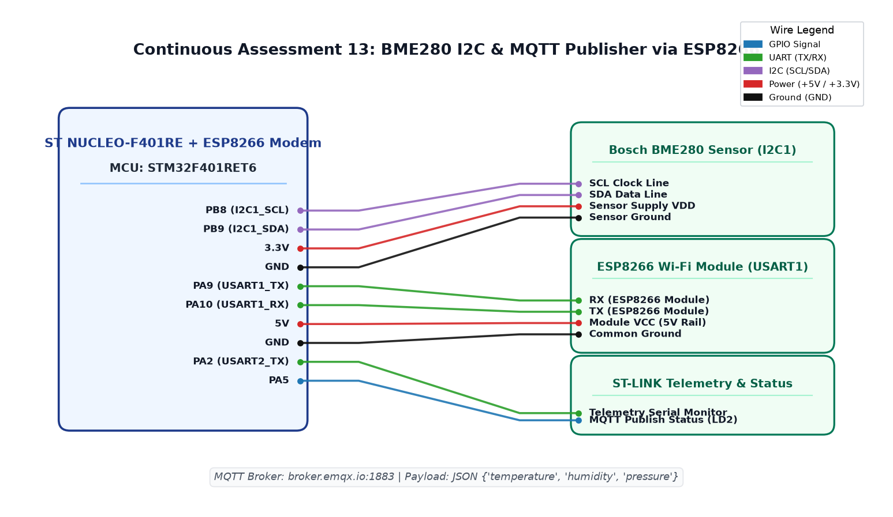

# CAT13 TASK13: Cloud IoT Telemetry Ingestion — BME280 + ESP8266 MQTT Publisher

**Course:** 25CS2741 Fundamentals of Internet of Things + Lab  
**Student:** Yazhini J E (Reg No: 25011102119)  
**Institution:** Shiv Nadar University Chennai  
**Date:** 02/11/2026  
**Platform:** STM32 NUCLEO-F401RE + ESP8266 + BME280  
**Core Clock:** 84 MHz  

---

## 1. Overview & Objectives
This capstone experiment implements an end-to-end Edge-to-Cloud IoT telemetry node. The STM32 microcontroller samples environmental metrics from a BME280 sensor over I2C, encapsulates the measurements into a JSON payload, and commands an attached ESP8266 Wi-Fi modem to publish the payload to an MQTT Broker (`broker.hivemq.com` / Adafruit IO) under the course telemetry topic:
`iot/snuc/25011102119/sensors`

---

## 2. Network & Cloud Credentials (Sanitized)
- **Wi-Fi SSID:** `YOUR_WIFI_SSID`
- **Wi-Fi Password:** `YOUR_WIFI_PASSWORD`
- **MQTT Broker:** `broker.hivemq.com` (Port 1883)
- **MQTT Client ID:** `STM32_FIoT_25011102119`
- **Publish Topic:** `iot/snuc/25011102119/sensors`

---

## 3. Circuit Schematic

---

## 4. Build, Flashing & Execution
1. Open `MDK-ARM/Weather_MQTT.uvprojx` in Keil µVision.
2. Build and flash target firmware.
3. Subscribe to `iot/snuc/25011102119/sensors` on an MQTT client (e.g. MQTTX); verify live incoming sensor readings.
