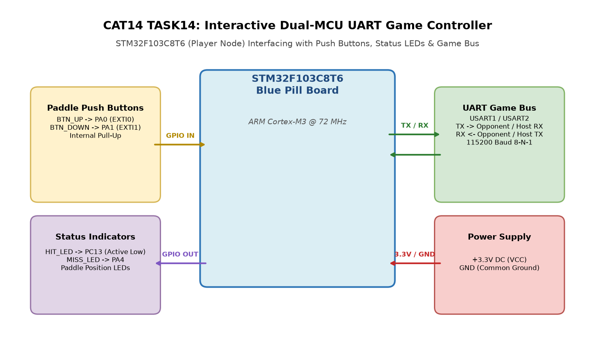

# CAT 14: Interactive Dual-MCU UART Game Controller

**Course:** 25CS2741 Fundamentals of Internet of Things + Lab  
**Student:** Yazhini J E (Reg No: 25011102119)  
**Institution:** Shiv Nadar University Chennai  
**Date:** 09/11/2026  
**Platform:** STM32F103C8T6 (Blue Pill ARM Cortex-M3 @ 72 MHz)  

---

## Experiment Overview
This project implements the Player Node for a networked real-time dual-MCU PingPong game controller. Interfacing push-button paddle controls, status LEDs (Hit/Miss), and communicating with an opponent MCU over full-duplex UART at 115200 baud.

## Tasks
- **[TASK 14: PingPong Player Node](TASK14/)**: Full Keil project, CubeMX configuration, and game state machine.

## Circuit Diagram

