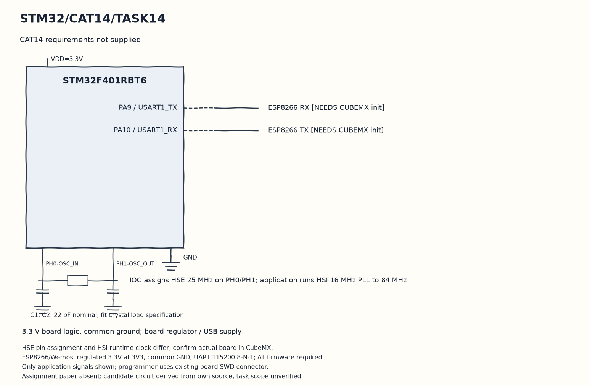

EXPERIMENT DETAILS
EXP: CONTINUOUS ASSESMENT 14
DATE: 14/11/2026
NAME OF EXP: CAT14 paper not supplied
HARDWARE SETUP / PLATFORM: STM32F401RB development board (physical board unconfirmed) + STM32F401RBT6 + ESP8266 + STM32CubeMX (MDK-ARM project)
TASK 14 : CAT14 requirements not supplied

1. Circuit Diagram
Publish the greeting every second after UART initialization to demonstrate 14 with the shown signals.

* Microcontroller / Board: STM32F401RB development board (physical board unconfirmed) + STM32F401RBT6.
* GPIO / Peripheral pins: PA9 / USART1_TX -> ESP8266 RX; PA10 / USART1_RX -> ESP8266 TX.
* Clock: HSI 16 MHz PLL to 84 MHz.
* External components / Peripheral: ESP8266 RX; ESP8266 TX.
* Power Supply: 3.3 V board logic, common ground; board regulator / USB supply.

2. Core Logic / Pseudocode / Code Base
Working Principle: The candidate source connects an ESP library client and publishes Good Morning on stm32/data. The USART1 handle and startup initialization are now provided before ESP setup.

Pseudocode:

1. Initialize HAL, the stored clock and GPIO.
2. Initialize USART1 and use huart1 for the saved ESP connection sequence.
3. Connect the MQTT client to the broker stored in the source.
4. Publish the greeting every second after the UART setup is supplied.

Code Base:
The program is written in Embedded C using STM32 HAL (STM32CubeMX).

* `main.h` provides the project HAL declarations in this program.
* `ESPLib.h` declares the own ESP and MQTT library interface in this program.
* `ESP8266_Init()` tests and configures the ESP station interface here.
* `ESP8266_wifiConnect()` sends the saved access-point connection settings here.
* `ESP8266_portConnect()` opens the stored TCP broker connection here.
* `MQTT_connectBroker()` sends the MQTT client connection packet here.
* `MQTT_publishTopic()` sends the topic and application payload through the ESP library here.
* `HAL_Delay()` waits for the programmed millisecond interval here.

3. Inference
This candidate is a greeting publisher, not verified CAT14 assignment evidence. The missing paper prevents title and scope verification, and target build and hardware communication remain unverified.

Configuration correction: USART1 PA9/PA10 at 115200 baud, 8-N-1, initialized before ESP8266_Init. Configure Wi-Fi credentials locally. Existing F401RB device target retained; confirm physical board and assignment scope.

Date note: no paper was available, so the date uses the original candidate lab file last-modified date. Experiment and task wording above report the absent requirements rather than invent a title.

## Node-RED MQTT Subscriber Flow

A Node-RED flow is provided in [flows.json](flows.json) to receive and display the MQTT messages published by the STM32.

### MQTT Configuration

| Parameter | Value |
|---|---|
| Broker | broker.emqx.io |
| Port | 1883 |
| Topic | stm32/data |
| QoS | 0 |
| Client ID | NodeRED_Subscriber_CAT14 |
| Published Message | Good Morning |
| Publish Interval | 1000 ms |

### Flow Nodes

1. **MQTT In** – Subscribes to `stm32/data` on `broker.emqx.io:1883`
2. **Debug** – Displays raw incoming messages in the debug sidebar
3. **Add Timestamp** – Attaches reception timestamp and running message count
4. **Dashboard Text (Message)** – Displays the latest message from STM32
5. **Dashboard Text (Timestamp)** – Shows when the last message was received
6. **Dashboard Text (Count)** – Shows total messages received

### How to Import

1. Open Node-RED in a browser (`http://localhost:1880`).
2. Click the menu (top right) and select **Import**.
3. Click **Select a file to import** and choose `flows.json`.
4. Click **Import** and then **Deploy**.
5. Open the Dashboard at `http://localhost:1880/ui`.
6. The dashboard displays the latest `Good Morning` message, timestamp and count.

### Required Node-RED Palettes

- `node-red-dashboard` (for `ui_text`, `ui_group`, `ui_tab` nodes)

Install via: **Menu → Manage Palette → Install → search `node-red-dashboard`**