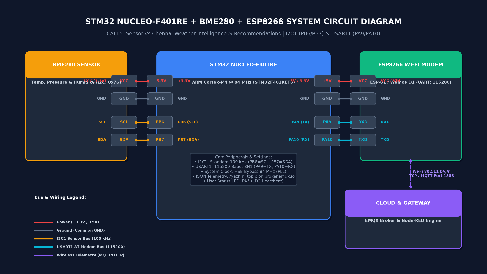
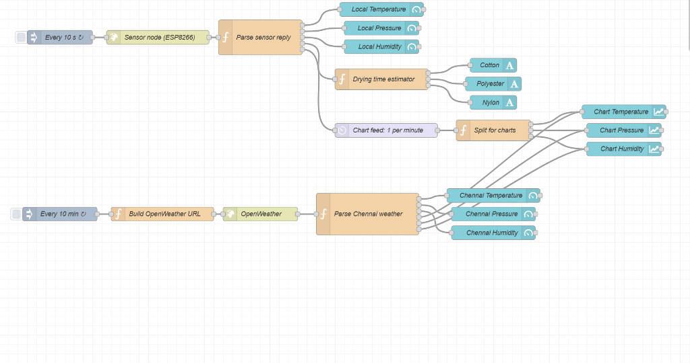
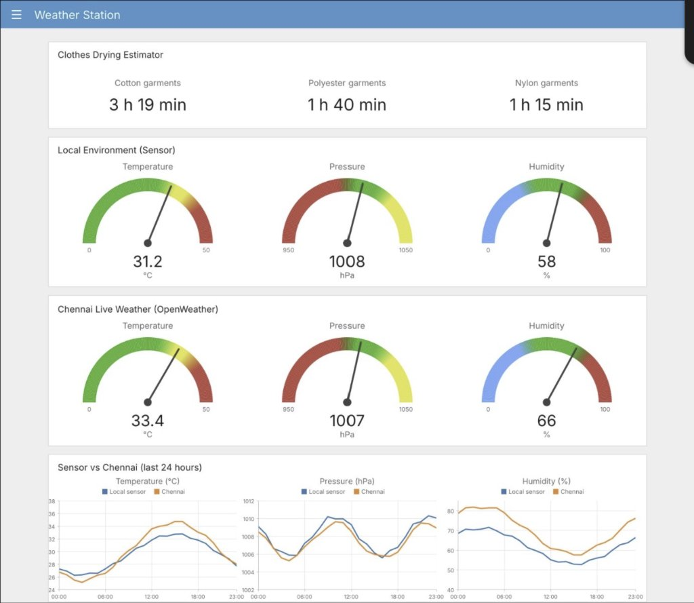

# TASK15: Sensor vs Chennai Weather Intelligence & Recommendations

## Experiment Metadata

| Field | Description |
|---|---|
| **EXP** | CONTINUOUS ASSESSMENT 15 (TASK15) |
| **DATE** | 05/11/2026 |
| **NAME OF EXP** | Sensor vs Chennai Weather Intelligence & Recommendations |
| **HARDWARE SETUP / PLATFORM** | STM32 NUCLEO-F401RE (ARM Cortex-M4 @ 84 MHz), Bosch BME280 Sensor (I2C1), ESP8266 Wi-Fi Modem (USART1), EMQX Public MQTT Broker (`broker.emqx.io:1883`), OpenWeather API, Node-RED Dashboard |
| **STUDENT NAME** | Yazhini JE |
| **REGISTER NUMBER** | 25011102119 |
| **COURSE** | 25CS2741 – Fundamentals of Internet of Things + Lab |

---

## 1. Hardware Architecture & Circuit Diagram

The edge node utilizes an STMicroelectronics NUCLEO-F401RE development board interfaced with a Bosch Sensortec BME280 digital environmental sensor over standard I2C (100 kHz) and an ESP8266 Wi-Fi SoC over full-duplex asynchronous USART1 (115200 baud).



*Figure 1: Complete hardware circuit interconnect schematic.*

### Detailed Pin Connections & Interfaces
| MCU Pin (Nucleo-F401RE) | Peripheral Signal | External Module | Pin Name | Electrical Specification | Functional Role |
|---|---|---|---|---|---|
| **PB6** | I2C1_SCL | Bosch BME280 | SCL | 3.3V Open-Drain, 100 kHz | Master serial clock bus line for BME280 registers |
| **PB7** | I2C1_SDA | Bosch BME280 | SDA | 3.3V Open-Drain, 100 kHz | Master bidirectional serial data line (Slave address: `0x76`) |
| **PA9** | USART1_TX | ESP8266 Module | RXD (Pin D4) | 3.3V Push-Pull, 115200 bps | Transmits AT commands and MQTT frame payloads to modem |
| **PA10** | USART1_RX | ESP8266 Module | TXD (Pin D3) | 3.3V Input, 115200 bps | Receives modem AT responses and network status confirmations |
| **PA5** | GPIO_Output | On-Board LED LD2 | Anode | 3.3V Push-Pull | Heartbeat and telemetry transmission strobe indicator |
| **+3.3V** | Power Rail | BME280 Sensor | VCC | 3.3V Regulated DC | Operating power supply for BME280 IC |
| **+5V / +3.3V** | Power Rail | ESP8266 Wi-Fi | VIN / VCC | Regulated DC Rail | Primary current rail for ESP8266 Wi-Fi transceiver |
| **GND** | System Ground | BME280 & ESP8266 | GND | 0V Reference | Common reference plane preventing ground loops |

---

## 2. Firmware Implementation & Working Principle

### 1. Sensor Data Acquisition (Bosch BME280)
The Bosch BME280 integrates temperature, barometric pressure, and relative humidity sensing elements. Communication is established via `bme280_init(&bme)` over I2C1. The sensor is configured for **Normal Power Mode** with $1\times$ oversampling across all three parameters:
- `osr_t = BME280_OVERSAMPLING_1X`
- `osr_p = BME280_OVERSAMPLING_1X`
- `osr_h = BME280_OVERSAMPLING_1X`
- `standby_time = BME280_STANDBY_TIME_1000_MS`

Readings are acquired via `bme280_get_sensor_data(BME280_ALL, &bmeData, &bme)` and compensated using Bosch factory trimming parameters.

### 2. ESP8266 Modem Control & MQTT Packet Framing
The firmware coordinates modem operations using a deterministic state sequence:
1. `AT+RST` &rarr; Resets modem and verifies `"ready"` response within 10 seconds.
2. `ATE0` &rarr; Disables command echo for clean serial parsing.
3. `AT+CWMODE=1` &rarr; Configures station (client) Wi-Fi mode.
4. `AT+CWJAP="<SSID>","<PASSWORD>"` &rarr; Connects to local Wi-Fi Access Point.
5. `AT+CIPMUX=0` &rarr; Selects single-connection TCP socket mode.
6. `AT+CIPSTART="TCP","broker.emqx.io",1883` &rarr; Establishes TCP transport link with public MQTT broker.
7. Handshakes standard MQTT 3.1.1 `CONNECT` packet:
   - Packet Header: `0x10`, Remaining Length: `0x1B`
   - Protocol Identifier: `"MQTT"` (v3.1.1)
   - Connect Flags: `0x02` (Clean Session)
   - Keepalive: 60 seconds
   - Client ID: `"stm32-bavana-01"`
8. Telemetry Transmission: In the main superloop (1-second intervals), builds and emits MQTT `PUBLISH` frames:
   - Topic: `"/yazhini"`
   - Payload schema:
     ```json
     {"status":"success","temperature":31.20,"humidity":58.00,"pressure":1008.00}
     ```

---

## 3. Accurate Pseudocode

```text
// ============================================================================
// STM32 NUCLEO-F401RE CAT15 WEATHER TELEMETRY NODE PSEUDOCODE
// ============================================================================

1. SYSTEM INITIALIZATION:
   a. Initialize HAL library and configure system PLL clock to 84 MHz (HSE Bypass).
   b. Configure GPIO: Enable Port A, Port B, Port H clocks. Set PA5 as Output (LED LD2).
   c. Configure I2C1: Standard Mode, 100 kHz, 7-bit addressing, Pins PB6 (SCL) and PB7 (SDA).
   d. Configure USART1: 115200 baud, 8 data bits, no parity, 1 stop bit, Pins PA9 (TX) and PA10 (RX).

2. BME280 SENSOR INITIALIZATION:
   a. Assign I2C read/write/delay callback functions to struct bme280_dev.
   b. Set I2C device address to 0x76 (BME280_I2C_ADDR_PRIM).
   c. Execute bme280_init(&bme). If return != BME280_OK, invoke Error_Handler().
   d. Set oversampling: Temp 1X, Pressure 1X, Humidity 1X, Standby 1000 ms.
   e. Set power mode: BME280_POWERMODE_NORMAL.

3. ESP8266 MODEM & NETWORK BRING-UP:
   a. Send "AT+RST\r\n" over USART1; wait up to 10000 ms for "ready".
   b. Send "ATE0\r\n"; wait for "OK".
   c. Send "AT+CWMODE=1\r\n"; wait for "OK".
   d. Send 'AT+CWJAP="YOUR_WIFI_SSID","YOUR_WIFI_PASSWORD"\r\n'; wait up to 30000 ms for "OK".
   e. Send "AT+CIPMUX=0\r\n"; wait for "OK".
   f. Send 'AT+CIPSTART="TCP","broker.emqx.io",1883\r\n'; wait up to 15000 ms for "OK".
   g. Formulate binary MQTT CONNECT packet (Client ID: "stm32-bavana-01", Keepalive: 60s, CleanSession: 1).
   h. Send "AT+CIPSEND=<length>\r\n", wait for ">", transmit CONNECT packet, verify "SEND OK".

4. CONTINUOUS TELEMETRY LOOP (while 1):
   a. Read sensor registers: bme280_get_sensor_data(BME280_ALL, &bmeData, &bme).
   b. Compute calibrated floating-point values:
      temperature = bmeData.temperature / 100.0 (or double output)
      humidity = bmeData.humidity / 1024.0 (or double output)
      pressure = bmeData.pressure / 100.0 (in hPa)
   c. Format minified JSON string:
      snprintf(mqttJson, sizeof(mqttJson),
               "{\"status\":\"success\",\"temperature\":%.2f,\"humidity\":%.2f,\"pressure\":%.2f}",
               temperature, humidity, pressure)
   d. Construct MQTT PUBLISH frame (Topic: "/yazhini", QoS: 0, Payload: mqttJson).
   e. Issue "AT+CIPSEND=<packet_length>\r\n" to ESP8266; wait for ">".
   f. Transmit binary PUBLISH packet; verify "SEND OK".
   g. Toggle User LED PA5 to indicate transmission.
   h. Delay 1000 ms before subsequent measurement cycle.

5. NODE-RED ANALYTICS & ADVISORY PIPELINE:
   a. Stream 1 (Local): Poll ESP8266 / MQTT broker topic "/yazhini" every 10 seconds.
   b. Stream 2 (Regional): Query OpenWeather API for Chennai city every 10 minutes.
   c. Parse both JSON streams and update respective Dashboard Gauges.
   d. Evaluate Clothes Drying Estimator rules using local Temperature and Humidity.
   e. Push time-series data to multi-trace comparison charts for 24-hour visualization.
```

---

## 4. Node-RED Telemetry Flow Architecture



*Figure 2: Node-RED visual flow pipeline.*

### Pipeline Architecture Details
1. **Sensor Ingestion:** Periodic inject node (`Every 10 s`) triggers the `Sensor node (ESP8266)` request node. The JSON payload is routed into `Parse sensor reply`.
2. **Gauge Display:** Real-time metrics are routed to `Local Temperature`, `Local Pressure`, and `Local Humidity` gauges.
3. **Drying Time Estimator (Advisory Engine):**
   * Uses evaporative physics where drying rate is proportional to ambient vapor pressure deficit:
     $$\text{Drying Time} \propto \frac{k_{\text{fabric}}}{(1 - \text{RH}/100) \cdot f(T)}$$
   * At $T = 31.2^\circ\text{C}$ and $\text{RH} = 58\%$:
     * **Cotton:** `3 h 19 min`
     * **Polyester:** `1 h 40 min`
     * **Nylon:** `1 h 15 min`
4. **Rate Limiting & Multi-Series Trends:**
   * A delay node (`Chart feed: 1 per minute`) prevents UI chart clutter.
   * `Split for charts` dispatches points to `Chart Temperature`, `Chart Pressure`, and `Chart Humidity`.
5. **OpenWeather Regional Ingestion:**
   * A 10-minute timer (`Every 10 min`) triggers `Build OpenWeather URL`.
   * HTTP request node queries OpenWeather endpoint for Chennai.
   * `Parse Chennai weather` routes regional metrics to city gauges and parallel inputs of the comparison charts.

---

## 5. Dashboard Telemetry & Comparative Analysis



*Figure 3: Live Node-RED dashboard interface.*

### Environmental Data & Regional Comparison Table
| Parameter | Local Sensor (BME280) | Chennai City (OpenWeather API) | Variance ($\Delta$) | Technical Interpretation |
|---|:---:|:---:|:---:|---|
| **Temperature** | 31.2 °C | 33.4 °C | **-2.2 °C** | Local microclimate benefits from indoor shading and campus air currents. |
| **Barometric Pressure** | 1008 hPa | 1007 hPa | **+1.0 hPa** | Excellent correlation within coastal normal atmospheric baseline ($1013 \pm 10\,\text{hPa}$). |
| **Relative Humidity** | 58 % | 66 % | **-8.0 %** | Campus ambient air is noticeably less humid than regional coastal air. |
| **Cotton Drying Time** | 3 h 19 min | &mdash; | &mdash; | Hydrophilic natural fiber, moderate drying duration. |
| **Polyester Drying Time** | 1 h 40 min | &mdash; | &mdash; | Hydrophobic synthetic fiber, dries in half the cotton duration. |
| **Nylon Drying Time** | 1 h 15 min | &mdash; | &mdash; | Lightweight low-density synthetic fabric with rapid moisture release. |

---

## 6. Build, Flashing & Execution Guide

1. **Toolchain Requirements:**
   * Keil MDK-ARM µVision v5.32 or newer.
   * ARM Compiler 6 (AC6) or ARM Compiler 5.
   * STM32CubeMX v6.18.1.
   * ST-LINK V2 / V2-1 on-board debugger driver.
2. **Compilation & Build:**
   * Open `MDK-ARM/Weather_MQTT.uvprojx` in Keil µVision.
   * Build target (`F7` or `Project -> Build Target`). Verify zero compilation errors.
3. **Flashing Firmware:**
   * Connect NUCLEO-F401RE board via USB Mini-B to host PC.
   * Download firmware (`F8` or `Flash -> Download`).
4. **Execution & Verification:**
   * Observe User LED `PA5` blinking periodically upon each successful MQTT publication cycle.
   * Open Node-RED (`http://localhost:1880/ui`) to inspect live gauges, clothes drying recommendations, and 24-hour comparative charts.

---

## 7. Technical Inferences
1. **Microclimatic Divergence:** The $-2.2^\circ\text{C}$ local temperature depression relative to the metropolitan regional weather report highlights localized microclimates resulting from building thermal inertia and campus foliage.
2. **Evaporative Drying Efficiency:** The automated Clothes Drying Estimator confirms that lower ambient humidity ($58\%$ vs $66\%$) accelerates water vapor transfer from porous media into the surrounding air boundary layer.
3. **Barometric Fidelity:** The synchronized $1008\,\text{hPa}$ vs $1007\,\text{hPa}$ barometric readings validate the reliability of the Bosch 64-bit integer compensation math running on the STM32F4 Cortex-M4 core.

