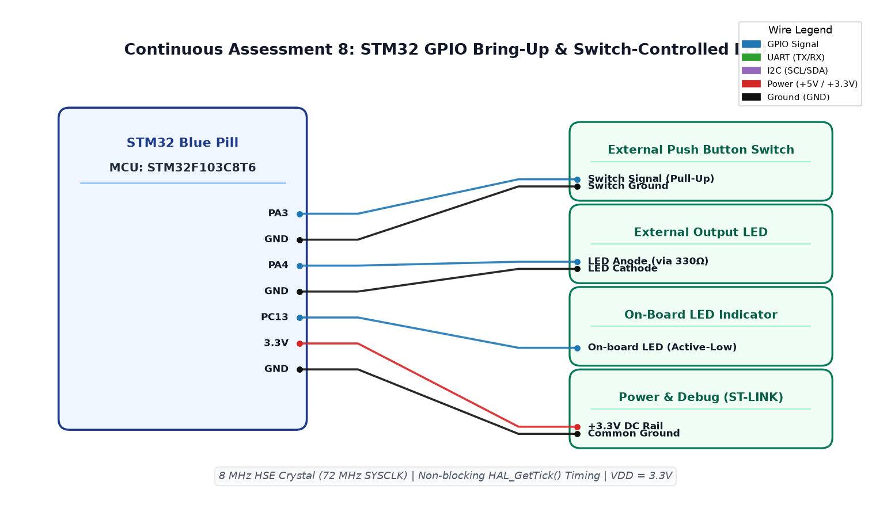

# EXPERIMENT DETAILS

**EXP:** CONTINUOUS ASSESSMENT 8  
**DATE:** 18/09/2026  
**NAME OF EXP:** STM32 GPIO Bring-Up and Switch-Controlled LED  
**HARDWARE SETUP / PLATFORM:** STM32 Blue Pill + STM32F103C8T6 MCU + Keil MDK-ARM + External Switch (PA3) + External LED (PA4) + On-Board LED (PC13)  

---

## TASK 8A : GPIO Input and Output Following Switch State

### 1. Circuit Diagram
- **Development Board:** STM32F103C8T6 Minimal Development Board (Blue Pill)
- **Microcontroller IC:** STM32F103C8T6 (ARM Cortex-M3, 72 MHz)
- **GPIO Pins:** 
  - `PA3` : GPIO Input with Internal Pull-Up (External push button connected to GND)
  - `PA4` : GPIO Output Push-Pull (External Red LED Anode via 330Ω resistor)
  - `PC13` : GPIO Output Open-Drain/Push-Pull (On-board User LED, active-LOW)
- **Peripherals:** Push button tactile switch, external 5mm red LED, 330Ω resistor
- **Power Supply:** 3.3V DC via ST-Link V2 / on-board regulator, common GND

### 2. Core Logic / Pseudocode / Code Base

**Working Principle:**  
The STM32 GPIO peripheral is initialized via STM32CubeMX HAL. In Task 8A, the CPU continuously polls the logic level of pin PA3 inside the super-loop. When the active-LOW switch is depressed, PA3 is pulled to 0V (RESET), prompting the controller to assert PA4 HIGH (turning the external LED ON). When the switch is released, PA3 pulls HIGH to 3.3V, causing PA4 to go LOW (turning the LED OFF).

**Pseudocode:**
1. Initialize HAL library and configure system clocks to 72 MHz via `SystemClock_Config()`.
2. Configure GPIO pins in `MX_GPIO_Init()`:
   - Enable `__HAL_RCC_GPIOA_CLK_ENABLE()` and `__HAL_RCC_GPIOC_CLK_ENABLE()`.
   - Set `PA3` as `GPIO_MODE_INPUT` with `GPIO_PULLUP`.
   - Set `PA4` and `PC13` as `GPIO_MODE_OUTPUT_PP` with `GPIO_SPEED_FREQ_LOW`.
3. In `main()` loop:
   - Read pin state using `HAL_GPIO_ReadPin(GPIOA, GPIO_PIN_3)`.
   - If pin reads `GPIO_PIN_RESET`:
     - Assert `HAL_GPIO_WritePin(GPIOA, GPIO_PIN_4, GPIO_PIN_RESET)`.
   - Else:
     - Assert `HAL_GPIO_WritePin(GPIOA, GPIO_PIN_4, GPIO_PIN_SET)`.

**Code Base:**
- `main.c` - Implements GPIO peripheral initialization, level detection, and output driving.
- `Ex8A.ioc` - STM32CubeMX graphical configuration project.
- Project folder: [`TASK_8A_GPIO_Input_Output`](TASK_8A_GPIO_Input_Output/)

### 3. INFERENCE
Direct polling provides immediate response tracking between the input contact and the output LED indicator. The internal pull-up resistor eliminates floating logic states on the input line.

---

## TASK 8B : Debounced Event-Based Toggle Control

### 1. Circuit Diagram
- **Development Board:** STM32 Blue Pill
- **Microcontroller IC:** STM32F103C8T6
- **GPIO Pins:** `PA3` (Input, Button), `PA4` (Output, LED), `PC13` (Output, LED)
- **Peripherals:** Tactile push button switch, LED indicator
- **Power Supply:** 3.3V DC, GND

### 2. Core Logic / Pseudocode / Code Base

**Working Principle:**  
Mechanical switch contacts generate transient chatter (bounce) during closing and opening transitions. Task 8B captures the falling edge (press) and rising edge (release) timestamped using the non-blocking millisecond tick counter `HAL_GetTick()`. Any contact closure lasting under 30 ms is rejected as electrical noise. Valid key releases toggle the LED latch state once per physical press.

**Pseudocode:**
1. Maintain state tracking variables: `prev = GPIO_PIN_SET` and `press_t = 0`.
2. In infinite loop:
   - Read `cur = HAL_GPIO_ReadPin(GPIOA, GPIO_PIN_3)`.
   - Fetch current timestamp `now = HAL_GetTick()`.
   - Detect falling edge (`prev == SET && cur == RESET`): record press start time `press_t = now`.
   - Detect rising edge (`prev == RESET && cur == SET`):
     - Calculate elapsed duration: `now - press_t`.
     - If duration $\ge 30 \text{ ms}$, toggle LED: `HAL_GPIO_TogglePin(GPIOA, GPIO_PIN_4)`.
   - Update `prev = cur`.

**Code Base:**
- `main.c` - Implements non-blocking software debouncing and edge-triggered state toggling.
- Project folder: [`TASK_8B_Event_Based_Control`](TASK_8B_Event_Based_Control/)

### 3. INFERENCE
Software debouncing via non-blocking time comparison successfully prevented false multiple-trigger oscillations without blocking background CPU execution. The LED reliably inverted state exactly once per physical button press.

---

## TASK 8C : Dual-Mode Duration Controller (Short Press vs Long Press)

### 1. Circuit Diagram
- **Development Board:** STM32 Blue Pill
- **Microcontroller IC:** STM32F103C8T6
- **GPIO Pins:** `PA3` (Input, Button), `PA4` (Output, LED), `PC13` (Output, LED)
- **Peripherals:** Push button, LED, 330Ω resistor
- **Power Supply:** 3.3V DC, GND

### 2. Core Logic / Pseudocode / Code Base

**Working Principle:**  
Task 8C introduces user interaction complexity by distinguishing between short momentary taps and sustained long holds. Using non-blocking `HAL_GetTick()`, the button hold duration is evaluated upon release. A short tap ($30 \text{ ms} \le \Delta t < 1000 \text{ ms}$) toggles the static state of the LED. A sustained hold ($\Delta t \ge 1000 \text{ ms}$) activates an asynchronous 2 Hz blinking mode (250 ms ON / 250 ms OFF). A subsequent tap halts the blinking mode.

**Pseudocode:**
1. Initialize `blink = 0`, `blink_t = 0`, `prev = SET`, `press_t = 0`.
2. In `while (1)` loop:
   - Read `cur = HAL_GPIO_ReadPin(GPIOA, GPIO_PIN_3)` and `now = HAL_GetTick()`.
   - On button press: record `press_t = now`.
   - On button release:
     - If `(now - press_t) >= 1000`: toggle `blink = !blink` (Long Press Mode).
     - Else if `(now - press_t) >= 30`:
       - If `blink` is active: clear `blink = 0`.
       - Else: toggle static LED state `HAL_GPIO_TogglePin(GPIOA, GPIO_PIN_4)`.
   - If `blink == 1` and `(now - blink_t) >= 250`:
     - Toggle LED output pins (`PA4` and `PC13`).
     - Update `blink_t = now`.

**Code Base:**
- `main.c` - Implements duration discrimination and dual-mode concurrent state-machine logic.
- Project folder: [`TASK_8C_Short_Press_vs_Long_Press`](TASK_8C_Short_Press_vs_Long_Press/)

### 3. INFERENCE
By strictly avoiding blocking `HAL_Delay()` functions, the microcontroller maintained responsive multi-rate timing: concurrently detecting microsecond switch edges while simultaneously pacing a 2 Hz continuous visual alert pattern.

