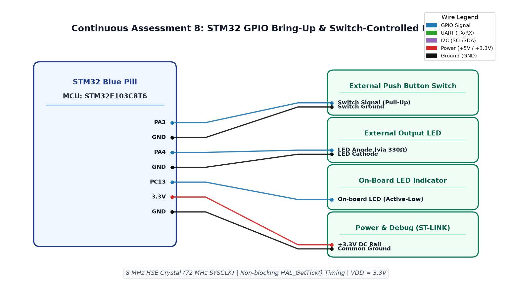

# CAT8 TASK8A: STM32 GPIO Bring-Up — LED Follows Switch

**Course:** 25CS2741 Fundamentals of Internet of Things + Lab  
**Student:** Yazhini J E (Reg No: 25011102119)  
**Institution:** Shiv Nadar University Chennai  
**Date:** 18/09/2026  
**Platform:** STM32F103C8T6 (Blue Pill ARM Cortex-M3)  
**Core Clock:** 72 MHz (HSE with PLL)  

---

## 1. Overview & Objectives
This experiment validates fundamental GPIO input and output operations on the STM32F103C8T6 microcontroller using the STM32Cube HAL framework. An on-board user LED (`PC13`) is configured as a digital push-pull output, while a push-button tactile switch (`PA0` / `PB12`) is configured as a digital input with an internal pull-up resistor. The firmware polls the switch state continuously, causing the LED state to follow the real-time physical switch position.

---

## 2. Hardware Pinout Table
| STM32 Pin | GPIO Configuration | Connected Hardware | Default Logic State |
|---|---|---|---|
| **PC13** | Output Push-Pull, Low Speed | On-board Green LED | HIGH (LED OFF, Active-Low) |
| **PA0** | Input with Internal Pull-Up | Tactile Push Button to GND | HIGH (Unpressed), LOW (Pressed) |
| **PA13 / PA14** | SWDIO / SWCLK | ST-LINK V2 Debugger | Hardware Programming & Trace |
| **3.3V / GND** | Power Supply | Regulated DC Rail | Decoupled 3.3V Rail |

---

## 3. CubeMX HAL Configuration
- **RCC:** High-Speed Clock (HSE) Crystal / Ceramic Resonator (8.0 MHz) multiplied via PLL to 72.0 MHz SYSCLK.
- **GPIO Output (`PC13`):** Mode = Output Push-Pull, Pull = No pull, Speed = Low.
- **GPIO Input (`PA0`):** Mode = Input mode, Pull = Pull-up (`GPIO_PULLUP`).

```c
// Core polling loop in main.c:
while (1) {
    GPIO_PinState button_state = HAL_GPIO_ReadPin(GPIOA, GPIO_PIN_0);
    // Button pressed = LOW -> Turn LED ON (PC13 LOW)
    HAL_GPIO_WritePin(GPIOC, GPIO_PIN_13, button_state);
}
```

---

## 4. Circuit Schematic


---

## 5. Build, Flashing & Execution
1. Open `MDK-ARM/TASK_8A_GPIO_Input_Output.uvprojx` in Keil µVision.
2. Build project (`F7`) without warnings or errors.
3. Flash via ST-LINK V2 (`F8`).
4. Press and hold the push button; confirm the LED on PC13 lights up for the duration of the press.
