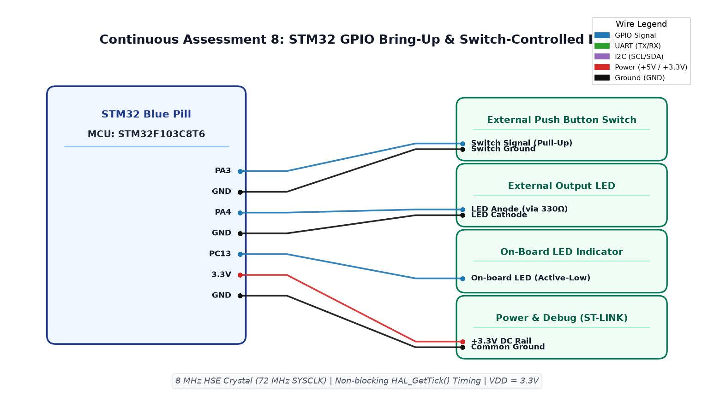

# CAT8 TASK8B: STM32 Event-Based Push-Button Toggle with Software Debounce

**Course:** 25CS2741 Fundamentals of Internet of Things + Lab  
**Student:** Yazhini J E (Reg No: 25011102119)  
**Institution:** Shiv Nadar University Chennai  
**Date:** 18/09/2026  
**Platform:** STM32F103C8T6 (Blue Pill ARM Cortex-M3)  
**Core Clock:** 72 MHz  

---

## 1. Overview & Objectives
This experiment advances GPIO control from continuous level polling to edge-triggered, event-based state toggling. The user LED on `PC13` toggles between persistent ON and OFF states upon each distinct button press. Software debouncing is implemented using `HAL_GetTick()` to filter out mechanical contact bounce without blocking CPU execution.

---

## 2. Software Debouncing Theory & Edge Detection
Mechanical switches oscillate mechanically for 10–30 ms when transitioning:
1. The firmware detects a **falling edge** (transition from `GPIO_PIN_SET` to `GPIO_PIN_RESET`).
2. When detected, the timestamp is verified: `if ((HAL_GetTick() - last_press_time) > DEBOUNCE_DELAY_MS)`.
3. If valid, the LED is toggled via `HAL_GPIO_TogglePin(GPIOC, GPIO_PIN_13)` and `last_press_time` is updated.
4. Subsequent contact bounces within the 50 ms window are rejected.

---

## 3. Circuit Schematic

---

## 4. Build, Flashing & Execution
1. Open `MDK-ARM/TASK_8B_Event_Based_Control.uvprojx` in Keil µVision.
2. Build and flash the target firmware via ST-LINK.
3. Press and release the push button rapidly; confirm that each physical click produces exactly one clean toggle of the LED.
