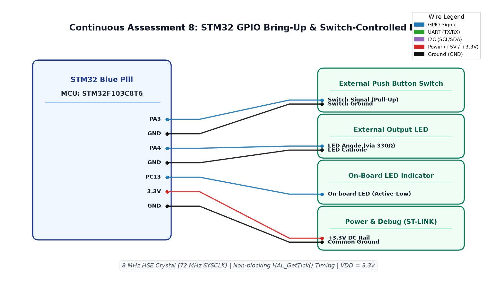

# CAT8 TASK8C: Non-Blocking Short Press (<1s) vs Long Press (>=1s) Controller

**Course:** 25CS2741 Fundamentals of Internet of Things + Lab  
**Student:** Yazhini J E (Reg No: 25011102119)  
**Institution:** Shiv Nadar University Chennai  
**Date:** 18/09/2026  
**Platform:** STM32F103C8T6 (Blue Pill ARM Cortex-M3)  
**Core Clock:** 72 MHz  

---

## 1. Overview & Objectives
This experiment develops a multi-modal user interface on a single push button using precise duration measurement with `HAL_GetTick()`. The system operates in a completely non-blocking cooperative multitasking architecture:
- **Short Press (< 1000 ms):** Toggles LED on `PC13` between static ON and OFF.
- **Long Press (>= 1000 ms):** Enters or exits a continuous 5 Hz blinking mode.

---

## 2. Non-Blocking Timing Architecture
```c
uint32_t press_start_time = 0;
uint8_t button_pressed = 0;
uint8_t blink_mode = 0;
uint32_t last_blink_tick = 0;

if (HAL_GPIO_ReadPin(GPIOA, GPIO_PIN_0) == GPIO_PIN_RESET) {
    if (!button_pressed) {
        button_pressed = 1;
        press_start_time = HAL_GetTick();
    }
} else {
    if (button_pressed) {
        uint32_t duration = HAL_GetTick() - press_start_time;
        button_pressed = 0;
        if (duration >= 1000) {
            blink_mode = !blink_mode; // Toggle 5 Hz Blinking mode
        } else if (duration > 50) {
            blink_mode = 0;
            HAL_GPIO_TogglePin(GPIOC, GPIO_PIN_13);
        }
    }
}

if (blink_mode && (HAL_GetTick() - last_blink_tick >= 100)) {
    last_blink_tick = HAL_GetTick();
    HAL_GPIO_TogglePin(GPIOC, GPIO_PIN_13);
}
```

---

## 3. Circuit Schematic


---

## 4. Build, Flashing & Execution
1. Open `MDK-ARM/TASK_8C_Short_Press_vs_Long_Press.uvprojx` in Keil µVision.
2. Build and flash the firmware.
3. Test short clicks (< 1s): LED toggles ON/OFF.
4. Press and hold for >= 1s: LED begins rapid 5 Hz blinking.
