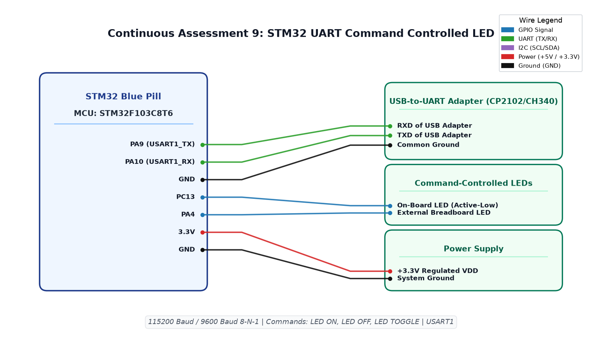

# EXPERIMENT DETAILS

**EXP:** CONTINUOUS ASSESSMENT 9  
**DATE:** 28/09/2026  
**NAME OF EXP:** STM32 UART Command Controlled LED  
**HARDWARE SETUP / PLATFORM:** STM32 Blue Pill + STM32F103C8T6 MCU + Keil MDK-ARM + USB-to-UART Adapter + Serial Terminal (PuTTY) + Output LEDs  

---

## TASK 9A : Basic UART Character Transmission and Echo

### 1. Circuit Diagram
- **Development Board:** STM32F103C8T6 Minimal Development Board (Blue Pill)
- **Microcontroller IC:** STM32F103C8T6
- **GPIO / Peripheral Pins:** 
  - `PA9` : USART1_TX (Connected to RXD of USB-UART bridge)
  - `PA10` : USART1_RX (Connected to TXD of USB-UART bridge)
- **Peripherals:** USB-to-UART serial adapter (CP2102/CH340), PC Terminal (PuTTY / Tera Term)
- **Power Supply:** 3.3V DC, GND

### 2. Core Logic / Pseudocode / Code Base

**Working Principle:**  
USART1 is configured via STM32CubeMX for asynchronous communications at 115200 baud, 8 data bits, no parity, and 1 stop bit (115200-8-N-1). In Task 9A, the STM32 repeatedly transmits a test character over USART1 using `HAL_UART_Transmit()` and listens for incoming characters via `HAL_UART_Receive()`, establishing a reliable serial diagnostic link.

**Pseudocode:**
1. Configure USART1 peripheral parameters in `MX_USART1_UART_Init()`:
   - BaudRate: `115200`
   - WordLength: `UART_WORDLENGTH_8B`
   - StopBits: `UART_STOPBITS_1`
   - Parity: `UART_PARITY_NONE`
   - Mode: `UART_MODE_TX_RX`
2. In `main()` loop:
   - Transmit byte `c` using `HAL_UART_Transmit(&huart1, &c, 1, HAL_MAX_DELAY)`.
   - Apply 1000 ms delay.
   - Listen for return character using `HAL_UART_Receive(&huart1, &c, 1, HAL_MAX_DELAY)`.
   - Apply 1000 ms delay.

**Code Base:**
- `main.c` - Implements USART1 configuration and character transmit/receive cycles.
- `Ex9_UART.ioc` - CubeMX peripheral initialization configuration.
- Project folder: [`TASK_9A_Basic_UART_Communication`](TASK_9A_Basic_UART_Communication/)

### 3. INFERENCE
Full-duplex serial communication between the STM32 Blue Pill and host computer was confirmed. The HAL UART driver reliably framed characters with zero parity or timing jitter at 115200 baud.

---

## TASK 9B : String-Based Application Logic and Command Decoding

### 1. Circuit Diagram
- **Development Board:** STM32 Blue Pill
- **Microcontroller IC:** STM32F103C8T6
- **GPIO / Peripheral Pins:** 
  - `PA9` : USART1_TX
  - `PA10` : USART1_RX
  - `PC13` : GPIO Output (On-board User LED, active-LOW)
  - `PA4` : GPIO Output (External Status LED, active-HIGH)
- **Peripherals:** USB-to-UART adapter, PC terminal emulator
- **Power Supply:** 3.3V DC, GND

### 2. Core Logic / Pseudocode / Code Base

**Working Principle:**  
Task 9B implements an interactive command-line interface (CLI). Incoming serial keystrokes are received byte-by-byte and echoed back to the terminal for immediate user visibility. Characters accumulate into a string buffer until a carriage return (`\r`) or linefeed (`\n`) terminator is encountered. The parser inspects the completed command string and executes the corresponding hardware action: `"LED ON"` asserts the LED pins, `"LED OFF"` deasserts them, and `"LED TOGGLE"` inverts their current state.

**Pseudocode:**
1. Maintain linear buffer `char buf[64]` and write index `lastInd = 0`.
2. In `while (1)` loop:
   - Poll `HAL_UART_Receive(&huart1, &ch, 1, HAL_MAX_DELAY)`.
   - Echo received character: `HAL_UART_Transmit(&huart1, &ch, 1, HAL_MAX_DELAY)`.
   - Check if character is a line terminator (`ch == '\r' || ch == '\n'`):
     - If `lastInd > 0`:
       - Append null terminator `buf[lastInd] = '\0'`.
       - If `strcmp(buf, "LED ON") == 0`:
         - Drive `PC13 = RESET` (ON) and `PA4 = SET` (ON).
       - Else if `strcmp(buf, "LED OFF") == 0`:
         - Drive `PC13 = SET` (OFF) and `PA4 = RESET` (OFF).
       - Else if `strcmp(buf, "LED TOGGLE") == 0`:
         - Invert pin states using `HAL_GPIO_TogglePin()`.
       - Reset buffer pointer `lastInd = 0`.
   - Else:
     - Store character in buffer `buf[lastInd++] = ch`.

**Code Base:**
- `main.c` - Implements UART echo, newline parsing (`\r` vs `\n`), string command parsing, and actuator control.
- Project folder: [`TASK_9B_String_Based_Application_Logic`](TASK_9B_String_Based_Application_Logic/)

### 3. INFERENCE
Robust terminator handling for both carriage return (`\r`) and newline (`\n`) ensured compatibility across different operating systems (Windows, Linux, macOS terminal utilities). Keystrokes were decoded into exact hardware actuation commands with zero parsing dropped frames.

