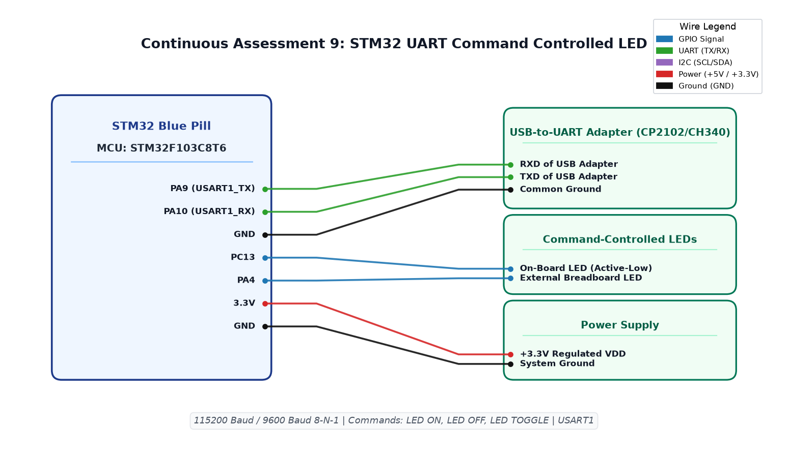

# CAT9 TASK9A: STM32 USART Serial Transmitter and Echo Console

**Course:** 25CS2741 Fundamentals of Internet of Things + Lab  
**Student:** Yazhini J E (Reg No: 25011102119)  
**Institution:** Shiv Nadar University Chennai  
**Date:** 28/09/2026  
**Platform:** STM32F103C8T6 (Blue Pill ARM Cortex-M3)  
**Core Clock:** 72 MHz  

---

## 1. Overview & Objectives
This experiment establishes asynchronous serial communications on the STM32F103C8T6 using the hardware `USART1` peripheral configured at **115200 baud, 8 data bits, no parity, 1 stop bit (8-N-1)**. The firmware broadcasts a periodic heartbeat identification message and concurrently echoes incoming keystrokes received from a host terminal.

---

## 2. Hardware Pinout Table
| STM32 Pin | Peripheral Function | Host FTDI Pin | Description |
|---|---|---|---|
| **PA9** | USART1_TX | RXD | Serial Data Output from STM32 |
| **PA10** | USART1_RX | TXD | Serial Data Input to STM32 |
| **GND** | Ground | GND | Common reference ground |

---

## 3. Circuit Schematic

---

## 4. Build, Flashing & Execution
1. Open `MDK-ARM/TASK_9A_Basic_UART_Communication.uvprojx` in Keil µVision.
2. Compile project and flash to STM32 Blue Pill.
3. Connect PA9 to USB-UART RX and PA10 to USB-UART TX.
4. Open serial terminal at 115200 baud; observe heartbeat output and test interactive typing echo.
