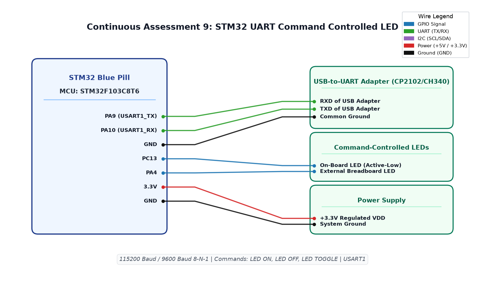

# CAT9 TASK9B: String-Based UART Command Parser (LED ON / OFF / TOGGLE)

**Course:** 25CS2741 Fundamentals of Internet of Things + Lab  
**Student:** Yazhini J E (Reg No: 25011102119)  
**Institution:** Shiv Nadar University Chennai  
**Date:** 28/09/2026  
**Platform:** STM32F103C8T6 (Blue Pill ARM Cortex-M3)  
**Core Clock:** 72 MHz  

---

## 1. Overview & Objectives
This experiment develops a command-line interface (CLI) parser over USART1. The firmware accumulates received ASCII characters into a line buffer until a carriage return (`\r`) or linefeed (`\n`) is encountered, then matches against recognized command strings:
- **`LED ON`**: Actuates `PC13` LED ON and responds `OK: LED IS ON\r\n`.
- **`LED OFF`**: Turns `PC13` LED OFF and responds `OK: LED IS OFF\r\n`.
- **`LED TOGGLE`**: Inverts `PC13` LED and responds `OK: LED TOGGLED\r\n`.
- Unrecognized inputs return `ERR: UNKNOWN COMMAND\r\n`.

---

## 2. Command Processing Logic
```c
if (strcmp(rx_buffer, "LED ON") == 0) {
    HAL_GPIO_WritePin(GPIOC, GPIO_PIN_13, GPIO_PIN_RESET);
    HAL_UART_Transmit(&huart1, (uint8_t*)"OK: LED IS ON\r\n", 17, 100);
} else if (strcmp(rx_buffer, "LED OFF") == 0) {
    HAL_GPIO_WritePin(GPIOC, GPIO_PIN_13, GPIO_PIN_SET);
    HAL_UART_Transmit(&huart1, (uint8_t*)"OK: LED IS OFF\r\n", 18, 100);
} else if (strcmp(rx_buffer, "LED TOGGLE") == 0) {
    HAL_GPIO_TogglePin(GPIOC, GPIO_PIN_13);
    HAL_UART_Transmit(&huart1, (uint8_t*)"OK: LED TOGGLED\r\n", 19, 100);
}
```

---

## 3. Circuit Schematic


---

## 4. Build, Flashing & Execution
1. Open `MDK-ARM/TASK_9B_String_Based_Application_Logic.uvprojx` in Keil µVision.
2. Build and flash the firmware.
3. In terminal, type `LED ON` -> LED lights up; `LED OFF` -> LED turns off.
